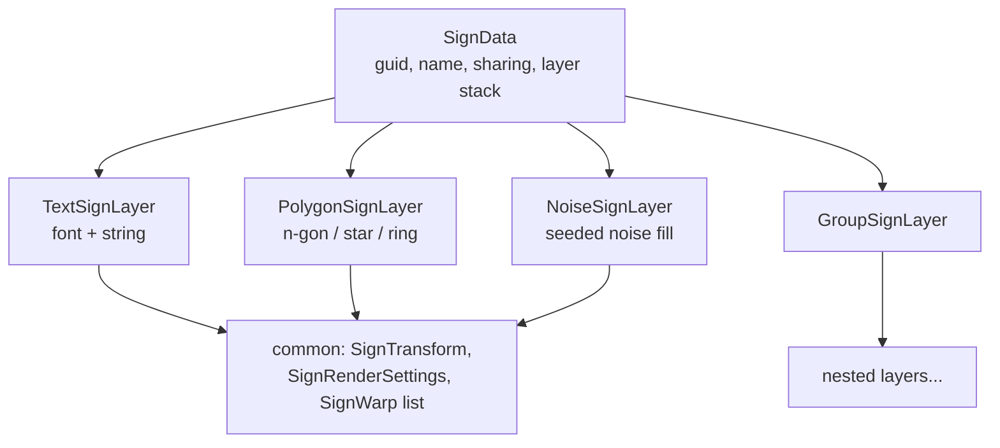
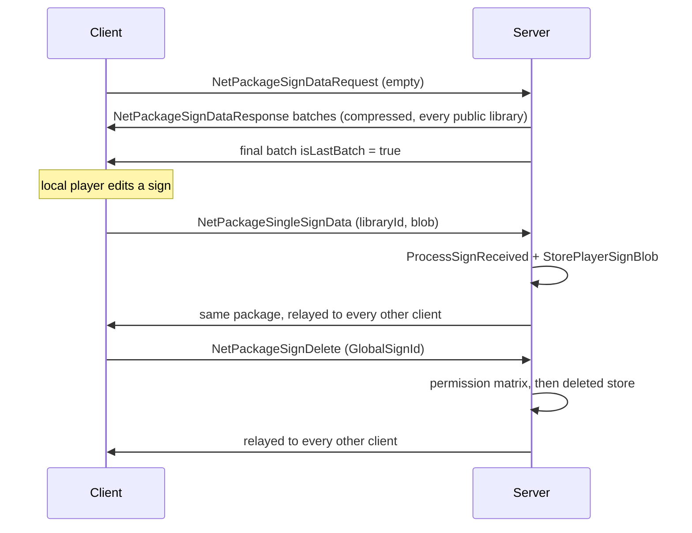

# Signs, authored text, and player sign libraries (dedicated V3.3.0)

**Owns:** the layered vector-sign ("drawing") content system: `SignData` and its
layer tree (`SignLayer`, `TextSignLayer`, `PolygonSignLayer`, `NoiseSignLayer`,
`GroupSignLayer`, the eight `SignWarp` types, `SignTransform`,
`SignRenderSettings`), sign identity (`GlobalSignId`) and storage (`SignLibrary`,
`SignLibraryMigrations`, `SignDataManager`, and in V3.3.0 the per-player stores
`PlayerSignStore` / `DeletedSignStore` over the shared `SignStoreIO` container),
the three sharing modes (`SignData.SignSharing`), ownership and deletion
(`NetPackageSignDelete`, `DeletedSignStore`), the sign-data wire
(`NetPackageSignDataRequest/Response`, `NetPackageSingleSignData`,
`NetPackageSignDelete`), and the authored-text moderation stack (`AuthoredText`,
`GeneratedTextManager` + `AuthoredTextDetails`). Also maps the client-only render
pipeline (`SignRenderer`, `SignPrioritizer`, `SignTextureManager/Store`,
`BakeScheduler`, `ImposterSignFactory`) far enough to show it is not server work.
**`SignCanvas` straddles the line:** the MonoBehaviour and its decal rendering
are client, but its nested **`SignCanvas.CanvasState` is server-persisted state**
(`TEFeatureCanvas.Read`/`Write` call `CanvasState.Read`/`Write` directly, see
§8), so do not treat the whole type as client-only.
**Not:** the tile-entity features that carry this data on a block
(`TEFeatureSignable`, `TEFeatureCanvas`, inventoried in
[../inventories/te-features.md](../inventories/te-features.md)); tile-entity
replication and persistence mechanics, including where a client-sent feature
write is validated on the server
([tile-entities-power.md](../gameplay/tile-entities-power.md)); the lock stream
itself (`LockManager`, `NetPackageLockTarget`, `docs/network/`); chat-text
filtering call sites ([chat.md](../social/chat.md)); platform blocklist plumbing
([platform-auth.md](../admin/platform-auth.md)); sign analytics (there are none,
see §6).
**Evidence:** IL of `SignData` (+ nested layer/warp types), `SignLibrary`,
`SignLibraryMigrations`, `SignDataManager`, `GlobalSignId`, `PlayerSignStore`,
`DeletedSignStore`, `SignStoreIO`, `NetPackageSignDataRequest/Response`,
`NetPackageSingleSignData`, `NetPackageSignDelete`, `AuthoredText`,
`GeneratedTextManager`, `TEFeatureCanvas`, `TEFeatureSignable`, `SignCanvas`,
`SignPrioritizer`, `SignTextureManager`, the `XUiC_Sign*` windows;
`Data/Config/XUi_InGame/windows.xml` and `Data/Config/Localization.csv` for the
shipped UI strings. Dump locally with `tools/src/DumpMethod`, git-ignored.
**Hub:** [`INDEX.md`](../INDEX.md). **Method:**
[`re-methodology.md`](../meta/re-methodology.md).
**Version:** §§1-8 re-checked against V3.3.0 b18. The bake and render bullets in
§9 were not re-derived for b18; the sign layer/warp types they walk are
field-identical to b10, but treat those bullets as a b10 reading.

V3.0.1 through V3.2.0 contain two "sign" systems that share nothing but the
word:

1. **Writable text signs** (the classic gameplay feature): a player types a
   string into a sign block; the string plus its author id is an `AuthoredText`
   persisted by `TEFeatureSignable` and moderated per viewer.
2. **Layered drawing signs** (the V2.x "SignTech" system): procedural vector
   art described as a stack of text/polygon/noise layers (`SignData`), stored in
   named libraries, referenced from blocks by `GlobalSignId` via
   `TEFeatureCanvas`, and rasterized entirely on the client by a compute-buffer
   bake pipeline.

V3.3.0 turns the second system into a player feature and gives it server-side
storage. A player who owns (or is in the party that owns) the land claim under a
sign canvas can open the gallery, draw a sign in the editor, place it on the
block, and choose who else may see, apply, or copy it. The drawings live in a
per-player library that the server persists under the save directory, not in the
tile entity and not in the prefab. There is no `TileEntitySign` type in any of
these builds; the writable-text model is `TEFeatureSignable` and it is
unchanged, so nothing was replaced. V3.3.0 adds a store and a sharing model on
top.

---

## 1. The layer model

`SignData` is one drawing: identity, sharing, and an ordered layer stack.

| `SignData` field | Meaning |
|---|---|
| `guid` | Stable identity within its library |
| `name` | Display name (gallery UI) |
| `sharing` | `SignSharing` byte, see §5 |
| `lastModified` | UTC timestamp (written as ticks) |
| `nextPolyId` / `nextTextId` / `nextNoiseId` / `nextGroupId` | Counters used by `SetLayerDefaultName` to number new layers |
| `layers` | `List<SignLayer>`, bottom-to-top paint order |
| `cCurrentBinaryVersion` | const 3, the blob version `Write` stamps (§2) |

Every `SignLayer` carries the shared fields `name`, a `SignTransform`
(`position: Vector2`, `rotation: float`, `scale: Vector2`, with
`op_Multiply` composing parent-child transforms), a `SignRenderSettings`
(`color: Color`, `mode` byte), and a `List<SignWarp>` of UV distortions. The
concrete subclasses add:

| Layer (binary `TypeId`) | Own fields |
|---|---|
| `GroupSignLayer` (0) | `offsetTarget` byte, `softnessOffset`, `dilateOffset`, `colorMode` byte, nested `List<SignLayer> layers` |
| `TextSignLayer` (1) | `font`, `text`, `direction`, `spacing`, `softness`, `dilate` |
| `PolygonSignLayer` (2) | `sides`, `smoothness`, `starify`, `softness`, `dilate`, `frequency`, `shapeMode` byte |
| `NoiseSignLayer` (3) | `seed`, `detail`, `softness`, `dilate`, `fade` |

Groups nest recursively; `SignData.UnpackLayers` flattens a group by
multiplying the parent `SignTransform` into each child, and
`GroupSignLayer` applies group-wide softness/dilate/color offsets to its
children (`SignDataManager.GroupOffsets.WithOffsets`).

Warps are a second polymorphic family under `SignData`, dispatched by their own
`TypeId` byte: `SkewWarp` (0), `BulgeWarp` (1), `TwirlWarp` (2), `KaleidoWarp`
(3), `PerspectiveWarp` (4), `ArcWarp` (5), `StretchWarp` (6), `GridWarp` (7).



`TextSignLayer.text` is drawing content typed in the sign editor. It is **not**
an `AuthoredText` and never passes through `GeneratedTextManager`; the
moderation stack (§8) applies only to the writable-sign path.

## 2. Serialization

**Binary** (`SignData.Write` IL=70 / `SignData.Read` IL=81) is the format of
every stored and pushed sign blob:

```text
int32  version            // Write stamps 3 (cCurrentBinaryVersion)
guid   guid               // 16 raw bytes, StreamUtils.Write/ReadGuid
string name               // BinaryWriter string: 7-bit length prefix + UTF-8
int64  lastModified       // DateTime.ToUniversalTime().Ticks
int32  nextPolyId
int32  nextTextId
int32  nextNoiseId
int32  nextGroupId
byte   sharing            // SignSharing
int32  layerCount
layer  layers[layerCount]
```

A layer writes its `TypeId` byte, then the subclass payload (`InternalWrite`),
then the shared tail: name string, transform (2+1+2 floats), render settings
(color + mode byte), warp count `int32`, warps (each again `TypeId` byte +
payload). `SignLayer.Read` switches on the byte and instantiates the matching
subclass; unknown ids throw.

`Read` rejects a blob whose version is `<= 0` or `> 3`
(`Sign blob version {0} is not readable by this build, which writes version
{1}.`), so versions 1 and 2 still load and are rewritten to 3 by the loader
(§4). `SignDataManager.DeserializeSign` IL=42 additionally rejects trailing
bytes (`SignData.Read and SignData.Write are out of sync`), the guard that
covers the new `sharing` byte.

**XML** (at rest, e.g. `Data/Config/signs.xml` and the per-prefab
`_signs.xml`): a `<sign>` element with attributes `guid`, `name`, `modified`,
`next_poly_id`, `next_text_id`, `next_noise_id`, `next_group_id`, plus
`sharing`, written only when it is not `Private` (`SignData.WriteXml` IL=83) and
parsed with `Enum.TryParse` in `SignData.ReadXML` IL=96, and one `<layer
type="TextSignLayer|PolygonSignLayer|GroupSignLayer|NoiseSignLayer" ...>` child
per layer (nested `<layer>` inside groups, `<warp>` children for warps).
`SignLayer.LayerFromXml` dispatches on the `type` string.

**Library files and versioning:** `SignLibrary` wraps a
`Dictionary<Guid, SignData>` read from a `<signs version="N">` document.
Current version is **2** (`SignLibrary.WriteXml` stamps `version="2"`).
`SignLibrary.ReadXml` logs duplicated guids, warns on missing version
("assuming legacy format (v0)") and on files newer than supported, then runs
`SignLibraryMigrations.Migrate` stepwise. `MigrateV0ToV1` is a no-op;
`MigrateV1ToV2` walks every layer (`VisitLayers`, recursing through
`GroupSignLayer` children) and resets `direction="0"` and `spacing="1"` on each
`TextSignLayer`, i.e. the meaning of those two attributes changed between v1
and v2.

## 3. Identity and libraries

`GlobalSignId` is a struct of `libraryId: string` + `signGuid: Guid`
(`ToString` renders `"{lib}:{guid}"`; stream form is the string plus 16 raw
guid bytes; an id with a null/empty library is invalid and logged as possible
malformed data). `SignDataManager` (plain singleton, created on both server and
client) keys everything on it and holds a `Dictionary<string, SignLibrary>`.

| Library id | Content | Loaded by |
|---|---|---|
| `[D]` | Default stock library, `Data/Config/signs.xml` | `WorldStaticData` static config table -> `SignDataManager.LoadDefaultLibrary` (both sides) |
| `[U]` | Local user's personal library (world editor / prefab editing) | Sign editor UI; never sent to clients |
| `[I]` | Internal: generated error placeholder sign (`SignData.GetErrorSignData`, a red polygon layer) | `LoadDefaultLibrary` epilogue |
| `<combinedId>` | Per-player library, one per platform user (`PlatformUserIdentifierAbs.CombinedString`, i.e. `<platformToken>_<id>`) | `SignDataManager.LoadPlayerSignLibraries` (server, §4); the owning client creates it by drawing |
| `<prefab name>` | Per-POI sign library, `<prefab>_signs.xml` next to the prefab | `Prefab.loadWorldSignData` (server only, `ConnectionManager.IsServer` gated); written back by `Prefab.Save` via `SignLibrary.WriteXml` |

**`SignDataManager` constants (IL):** `cSignSyncBatchBytes` = **1048576** (1 MB
per sync batch, still used by the join download), `cMaxComplexity` = **600**,
`cMaxCompStackIndex`/`cMaxUVStackIndex` = **7**, `baseDescriptorComplexity` =
**0.5**, `cPlayerSignWriteCooldownSeconds` = **60** (§4).

`SignDataManager..cctor` IL=14 builds `localLibraryIds` = `{ [I], [U] }`, the
"not a shared library" set used by the download, the gallery and the delete
check. `SignDataManager.IsPlayerLibraryId` IL=17 is the narrower test for a
per-player library: non-empty, not a local id, not `[D]`, and parseable as a
platform user identifier, so an arbitrary client-chosen string fails it.

`EnumeratePublicSignLibraries` yields every library whose id is not in
`localLibraryIds`, i.e. `[D]`, every prefab library **and every player library**.
That is exactly the set a server replicates, and it is why the download in §7 is
a privacy question.

`CopySignToLibrary` (two overloads; named `MoveSignToLibrary` before V3.3.0)
duplicates a sign into another library under a fresh guid and a de-duplicated
name. `TEFeatureCanvas.CopyFromInternal` IL=67 uses it so that a copied canvas
does not reference a foreign player's library: when the source canvas points at
a sign that is neither `[D]` nor already in the prefab's library, the sign is
copied into the prefab library and the canvas id is rewritten. The editor path
(`[U]` -> `[D]`) uses the same call. `GetLibraryNiceName` maps `[D]`/`[U]` to the
localized `lblSignLibraryDefault`/`lblSignLibraryUser` labels;
`GetPlayerLibraryOwnerName` IL=30 renders a player library as that player's
`PersistentPlayerName.DisplayName`.

## 4. Player sign libraries (new in V3.3.0)

Sign drawings authored in a live game are **not** tile-entity state. The server
keeps them per player and flushes them into the save directory:

| Where | What |
|---|---|
| `SignDataManager.signLibraries` | in-memory `SignLibrary` map, same as before, rebuilt on load |
| `SignDataManager.playerSignStates` | `Dictionary<string, PlayerSignLibraryState>`; key = player library id. State: `blobsByGuid : Dictionary<Guid, byte[]>`, `dirty`, `lastWriteTime`, `writeTask`, `writesBlocked` |
| `<saveGameDir>/Player/<libraryId>.signs` | `PlayerSignStore` image, container version 3, one `SignData` v3 blob per record |
| `<saveGameDir>/Player/<libraryId>.signs.bak` | previous image, written before every overwrite |
| `<saveGameDir>/Player/<libraryId>.signs.loadFailed` | preserved copy of a file that failed to parse (never overwritten) |
| `<saveGameDir>/deletedSigns.dat` (+ `.bak`) | `DeletedSignStore`: the deleted-sign id set, container version 1 |
| `SignDataManager.sessionDeletedSignIds` | ids deleted during this session, in-memory only |

Both files use the same container (`SignStoreIO`, header size 32):

```text
uint32 magic            // 0x4E475350 "PSGN" player store, 0x4E475344 "DSGN" deleted store
int32  version          // 3 for the player store, 1 for the deleted store
int32  recordCount
uint32 crc32(payload)   // Force.Crc32 over the payload bytes
int32  payloadLength    // header + payload must equal the file length
byte   flags            // bit 0 = overflowed (deleted store only)
byte[21] zero padding
```

Player-store payload: `recordCount` records of `int32 length` + `length` bytes,
each byte string a `SignData` blob (`PlayerSignStore.BuildImage` IL=47,
`PlayerSignStore.TryParseImage` IL=177). Deleted-store payload: `recordCount`
raw `GlobalSignId` stream forms, no per-record length
(`DeletedSignStore.BuildImage` IL=47). Constants: player store `CurrentVersion`
= `MinReadableVersion` = 3, `kMagic` = 1313297232; deleted store
`CurrentVersion` = `MinReadableVersion` = 1, `kMagic` = 1313297220,
`cMaxDeletedSigns` = 10000, overflow flag bit 0.

An interrupted write cannot be confused with data: `SignStoreIO.WriteWithBackup`
IL=22 renames the old file to `.bak` first, and `SignStoreIO.TryValidateHeader`
IL=146 checks magic, version window, declared payload length against the file
length, and crc32 before any record is parsed.

**Lifetime.** Server boot calls
`SignDataManager.LoadPlayerSignLibraries` IL=243 from
`GameManager.<StartAsServer>`. It returns immediately on a client, creates and
loads the `DeletedSignStore`, scans the player store directory for `*.signs` and
`*.signs.bak` (`PlayerSignStore.GetStoredLibraryIds` IL=18), skips ids that fail
`IsPlayerLibraryId` (`Skipping sign store with unrecognised player id`),
deserializes every record into a `SignLibrary` (logging and skipping individual
bad records), re-serializes and marks dirty when a blob needed a version
migration, registers the library, and finally calls
`DeletedSignStore.PruneExistingSigns` so a deletion record for a sign that is
back on disk is dropped. A library whose file cannot be read at all gets
`writesBlocked = true` for the session (`No readable sign store for player
'...'; ... Writes for this library are disabled for the session to avoid
overwriting it`); if every record of a readable store fails to deserialize, the
store is preserved and writes are blocked as well.

Every mutation (`AddSignToLibrary`, `TryDeleteSign`, `CopySignToLibrary`, and a
sharing change pushed from the client) marks the library dirty. Writes are
debounced per library to one per `cPlayerSignWriteCooldownSeconds` (60) in
`SignDataManager.Update` IL=87 (called from `GameManager.gmUpdate` IL=638) and
run on a `ThreadManager` task (`PlayerSignWriteTask` IL=5 ->
`WritePlayerSignImage` IL=23). `SignDataManager.Cleanup` IL=51 runs from
`GameManager.SaveAndCleanupWorld` IL=502 (reached from
`ConnectionManager.StopServers` IL=29 and
`ConnectionManager.DisconnectFromServer` IL=21), waits out any in-flight write
(`FlushPendingPlayerSignWrites` IL=44), flushes the deleted store, and clears
the libraries, player states, deleted-id set and render data. A single player
disconnecting from a running world has no sign-specific teardown: the libraries
belong to the save, not the connection, and stay loaded on the server until the
world is saved and cleaned up. Write and parse failures log
(`Failed to write sign store for '{0}'`), they do not throw.

Clients hold copies, not stores: on join `GameManager.<worldInfoCo>d__198` shows
`uiLoadDownloadingSigns` and runs `RequestWorldSignDataFromServer` (sends one
`NetPackageSignDataRequest`, then `yield return null` until the download flag
clears on the last batch, aborting if the connection drops), and
`ProcessSignDataBatchReceived` replays every `SignData.Read` into the client's
own map. Nothing is written to disk on a client.

**Old saves.** A V3.2.0 save keeps working because neither carrier of sign data
at that time changed. `TEFeatureCanvas` still persists
`SignCanvas.CanvasState` (same field order: `GlobalSignId`, blend byte,
canvas-rotation byte, show-on-imposter bool); the feature version is now 21, and
the reader keeps a legacy path for older feature versions (a discarded byte
below 18, blend mode at 19, canvas rotation at 20).
`TEFeatureSignable.AuthoredText` is byte-identical in layout. There were no
player libraries on disk before V3.3.0 (the old build had no reverse sign
package), so there is nothing to migrate; a `.signs` file from some other build
with a container version below 3 is unreadable by design
(`MinReadableVersion` = 3) and is preserved rather than overwritten.

## 5. Sharing modes

`SignData.SignSharing` is a byte enum on the blob: `Private` (0, the default),
`Selectable` (1), `Copyable` (2). The shipped strings
(`Data/Config/Localization.csv`) state the contract:

| Value | Shipped description | Behaviour |
|---|---|---|
| `Private` | "Only the author can see this design in the Sign Gallery and select it to apply to sign blocks." | Hidden from every other player's gallery list; the author can edit, apply, copy and share it. |
| `Selectable` | "Allies can select this design to apply to sign blocks but cannot edit or copy it." | Listed for allies, applicable to a canvas, not copyable, not editable. |
| `Copyable` | "Allies can select this design to apply to sign blocks and can make their own copies to freely edit and share." | Listed for allies, applicable, and copyable into the ally's own library. |

The audience is **allies**, not all players. The gallery
(`XUiC_SignGalleryWindow.RefreshItems` IL=259) builds its list from `[D]`, the
loaded prefab's library, the local user's own library, one library per ally from
`GameManager.Instance.persistentPlayers.Allies.EnumerateAllies(local.PrimaryId)`,
and world prefab libraries; there is no "all players" filter.
`SignDataManager.AddFilteredSignIdsToList` IL=68 then drops `Private` signs from
any player library that is not the local user's own. Copy permission is
`XUiC_SignInfoWindow.CheckCopyAllowed` IL=34: false for `[I]`/`[U]`, true for
`[D]` and prefab libraries, true for the local user's own library, and otherwise
true only when the effective sharing is `Copyable` and
`SignDataManager.IsLocalPlayerAlliedWith` IL=16 holds. That method parses the
library id as a platform user id and asks
`GameManager.persistentLocalPlayer.IsAlly(id)`
(`PersistentPlayerData.IsAlly` IL=8 -> `PersistentPlayerList.Allies.IsAlly`), so
the gate is the persisted ally store described in
[parties-factions.md](../social/parties-factions.md) §5, not party membership.
`GetEffectiveSharing` IL=10 returns `Private` for a sign that has no data.

The UI flow is `XUiC_SignSharingPrompt` (panel `sharingPrompt` inside
`windowSignInfo`, a `cbxSharing` combo over the enum plus Save/Cancel buttons,
`ShowPrompt` IL=28, `Result` = `Cancelled 0`, `Saved 1`). It opens for a sign in
a player library that passes `CheckEditsAllowed`; on `Saved` with a changed
value, `XUiC_SignInfoWindow.OnSharingPromptResult` IL=25 writes
`SignData.sharing`, bumps `lastModified` and calls `SignDataManager.MarkSignDirty`
so the new blob is pushed to the server.

**This is a client-side convention, not an access control.** The only reads of
`SignData.sharing` in the whole assembly are the two serializers, the gallery
filter, `GetEffectiveSharing`, and the info window's unchanged-value check
before it re-saves. No server method reads it, and the join download (§7) does
not filter on it, so every client already holds every player's `Private`
drawings; the stock UI merely hides them from the gallery. For a
reimplementation the sharing value is data a client can forge: it arrives inside
a server-accepted blob (§7) and the server has no rule about who may set it.

## 6. Ownership, deletion, and retention

A player deletes one of their signs from the gallery
(`XUiC_SignInfoWindow.DeleteSign` IL=34 -> `TryDeleteSign`, which deletes
locally and calls `SyncSignDelete`), and the server runs the permission matrix
in `NetPackageSignDelete.ProcessPackage` IL=122. Reading the branches in order,
on `ConnectionManager.IsServer`:

| Check | Rejected with |
|---|---|
| `signId.IsValid()` fails | `Received invalid sign id '{0}'; ignoring.` |
| `libraryId == "[D]"` | `... requested deletion of sign '{2}' from the default library; ignoring.` |
| `libraryId` in `localLibraryIds` (`[I]`, `[U]`) | `... from a local library; ignoring.` |
| player library and `libraryId != Sender.InternalId.CombinedString()` | `... which they don't own; ignoring.` |
| not a player library and `!PrefabEditModeManager.IsActive()` | `... from prefab library whilst not in prefab editor; ignoring.` |

Only the owner of a player library may delete from it; the default, internal and
local libraries are never deletable; a prefab library is deletable only on a
host in prefab edit mode. Every rejection logs the requesting player name and
internal id and does nothing else.

On success `SignDataManager.ProcessSignDeleteReceived` IL=5 ->
`TryDeleteSignLocal` IL=32 removes the blob from the in-memory library and calls
`HandlePlayerSignDeleted` IL=54, which adds the id to `sessionDeletedSignIds`
and to the `DeletedSignStore`, notifies render listeners, invalidates the baked
texture, and on the server calls `ReplaceLoadedSignReferences` IL=83: it walks
every loaded chunk's tile entities, and for each `TEFeatureCanvas` whose canvas
references the deleted id, swaps the reference to `SignData.defaultSignDataID`
(`[D]` + `Guid.Empty`) and marks the tile entity modified, so placed canvases
fall back to a stock sign instead of pointing at nothing. The package is then
rebroadcast to every client except the sender.

`DeletedSignStore` retains only the `GlobalSignId` set (cap `cMaxDeletedSigns` =
10000) and an overflow flag. When the set reaches the cap it is cleared, the
flag is set, and the server logs that from then on any missing player-made sign
is treated as deliberately deleted and silently replaced with the default sign
instead of logging an error; `TEFeatureCanvas.OnLoad` IL=54 then substitutes the
default sign without a warning, while a loaded canvas with no data and no
deletion record logs `references sign '...', which has no data but is not
recorded as deleted. The reference has been left intact in case the data can be
restored.` and leaves the reference alone.

**Audit and history: none.** Successful deletions are not logged, not counted,
and produce no analytics event (there is no sign reference anywhere under
`Services.Analytics`). The store keeps ids only, no actor and no timestamp, and
`PruneExistingSigns` silently drops records whose sign is back. The only
forensic trace of a deletion is the absence of the blob in the next `.signs`
write.

## 7. Network: one bulk download and two one-way pushes

V3.3.0 replaces the request/response pair for individual signs with one-way
pushes, mirroring the canvas model: the server owns the library set, clients
receive it and push their own edits. Three packages plus the unchanged request:



**Bulk download (unchanged shape).** `RequestWorldSignDataFromServer` is a
coroutine run from the client connect flow; it refuses to run on the server and
refuses re-entry while a download is in progress. `SendSignDataToClient` IL=144
refuses to run on a client, flattens every library from
`EnumeratePublicSignLibraries` into `(libraryId, SignData)` pairs, and packs them
into batches cut at `cSignSyncBatchBytes` = 1048576 bytes; each batch is a
`NetPackageSignDataResponse` (`Compress` = true, direction ToClient) carrying
`isLastBatch`, a length and the raw bytes: `string libraryId` then
`SignData.Write` per entry, behind a size marker. A batch that would hold nothing
still ships one empty `isLastBatch` response. Because player libraries are
"public" by the `localLibraryIds` test and `sharing` is not consulted here,
**the join download hands every connecting client every player's player-library
blobs, including `Private` ones.** The per-viewer hiding in §5 happens after the
bytes have arrived.

**Single-sign push.** `SignDataManager.SyncSignData` IL=37 serializes one
`SignData` and sends `NetPackageSingleSignData` (`Setup(libraryId, blob)`):
`string libraryId`, `int32 length`, `length` raw bytes. On the server it also
calls `StorePlayerSignBlob`; on a client it goes to the server. The receiving
side runs `SignDataManager.ProcessSignReceived` IL=31: deserialize, add to the
local library map, mark dirty, and on the server store the blob. The package
handler then rebroadcasts the same package to every client except the sender.
`StorePlayerSignBlob` IL=19 accepts only when the process is the server, the
library id passes `IsPlayerLibraryId`, and the blob is non-null.

**Delete push** is `NetPackageSignDelete` (§6).

**What the server validates on the upload path: the library id's shape only.**
`ProcessSignReceived` never examines `NetPackage.Sender`, and nothing compares
the wire `libraryId` with the sender's own combined id. A client can therefore
push a blob for any player library id the server will accept, including another
player's, with any `guid` (new, or overwriting an existing sign in that library)
and any `sharing` value; the server stores it in that player's `.signs` file and
relays it to the other clients. Deletion is ownership-checked (§6), upload is
not. The blob is also bounded only by the transport: no layer-count or
complexity check exists server-side (`cMaxComplexity` = 600 is a client render
budget). Both are recorded as residuals, not as claims about intent.

## 8. Blocks, canvas placement, authored text, and moderation

**Drawing placement** on a block is a reference: `TEFeatureCanvas` persists a
`SignCanvas.CanvasState` (stream order: `GlobalSignId`, blend-mode byte,
canvas-rotation byte, show-on-imposter bool) inside the composite tile entity,
so it rides normal TE replication and chunk persistence (see
[tile-entities-power.md](../gameplay/tile-entities-power.md)). At render time
`SignCanvas.DisplaySignId` falls back to `SignDataManager.ErrorSignId` when the
referenced sign is not in any loaded library.

**Who may open the editor changed in V3.3.0.** `TEFeatureCanvas.OnBlockActivated`
IL=74, `edit` command, non-editor branch: the client requires
`World.GetLandClaimOwnerInParty(player, player.persistentPlayerData)` and then
requests a lock with `LockManager.LockRequestLocal(this, 0)`; the editor opens
only when the lock grants (`OnLockResponseLocal` IL=5 -> `ShowUI` IL=22, which
shows `ttNoInteractItem`/`ui_denied` when refused). On a host in editor mode the
flow is the prefab-save prompt or the same lock request; an editor-mode client
that is not the host gets the tooltip `Cannot edit signs as client`.
`AllowBlockActivationCommand` IL=52 applies the same editor-or-claim-owner rule.
This is client-side gating: the server-side lock handler
`LockManager.LockRequestServer` IL=297 checks the request shape (1 to 5 targets,
resolvable targets, no existing lock state, single-lock exclusivity) and calls
`ILockTarget.OnLockRequestServer`, which `TEFeatureAbs` implements as an
unconditional `true`, so the claim check is not redone on the server. Whether the
composite tile-entity writeback that follows is validated server-side is `not
decoded` here and belongs to the tile-entity feature sync.

Committing a design is client-side too: `XUiC_SignGalleryWindow.ApplySelection`
IL=19 sets `SignCanvas.SignId` (in-memory state), then
`HandleInstanceSettingsChanged` marks the tile entity modified. `CreateNewSign`
IL=23 draws into the local user's player library (or the loaded prefab's library
in prefab edit mode) with `SignData.GetNewSignData`, then opens the editor.
`SignDataManager.MarkSignDirty` pushes a changed sign to the server (via
`SyncSignData`), while a change to a local library (`[I]`, `[U]`) never syncs.

**Writable text signs** still persist an `AuthoredText`: `text: string` +
`author: PlatformUserIdentifierAbs` (stream form via
`PlatformUserIdentifierAbs.FromStream/ToStream`). `XUiC_SignWindow` (window
`signMultiline`, opened by `TEFeatureSignable.ShowUI`) validates the string
against the mesh font (`CanRenderString`, tooltip `uiInvalidCharacters`) and
commits with `SetText(text, sync, localPlatformUserId)`, which updates the
`AuthoredText`, marks the TE modified (replicating raw text plus author to the
server), and re-renders locally. The game-event action `ActionRenameSigns`
(Twitch sequence) drives the same `ITileEntitySignable.SetText` path.

Moderation happens at **display** time, per viewing client, in
`GeneratedTextManager.GetDisplayText`:

- On a dedicated server (`GameManager.IsDedicatedServer`) the raw text is
  returned immediately: the server stores and forwards but never filters.
- If the author is not the local user and the author's
  `PersistentPlayerData.PlatformData.Blocked[EBlockType]` state says blocked, the
  text is replaced with `""` (the sign goes blank). The
  `TEFeatureSignable.UserBlockedStateChanged` hook re-runs this whenever the
  local blocklist changes.
- Otherwise the platform censor (`ITextCensor.CensorProfanity`) runs
  asynchronously with the author id; while pending, callers see the `{...}`
  placeholder, and the filtered result is cached in an `AuthoredTextDetails`
  keyed by the `AuthoredText` instance. BbCode is stripped before filtering and
  re-applied after (`GetTextToFilter` / `ReconstructFilteredTextWithBbCodes`).
- `ShouldSkipFiltering(author, mode)` switches on `TextFilteringMode`: value 0
  never filters, values 1 and 3 always filter, value 2 skips filtering when the
  author's native platform equals the local native platform (cross-platform
  text is the mandated filtering case).

The same `GeneratedTextManager` entry points serve chat, Twitch, waypoint
invites, player names (`PersistentPlayerName`), and server messages; only the
`TEFeatureSignable` call sites are in scope here.

## 9. Server-authoritative vs client-render split

Server-relevant (runs or matters on the dedicated server):

- `SignData`/`SignLayer` binary + XML serialization, `SignLibrary` +
  migrations, `[D]` default library load, prefab `_signs.xml` load/save
  (`Prefab.loadWorldSignData` / `Prefab.Save`).
- `SignDataManager` as library store and download service
  (`SendSignDataToClient`), the per-player store lifecycle
  (`LoadPlayerSignLibraries`, the 60 s write debounce, the `Cleanup` flush), the
  received-blob path (`ProcessSignReceived`, `StorePlayerSignBlob`), the delete
  path (`ProcessSignDeleteReceived`, `DeletedSignStore`,
  `ReplaceLoadedSignReferences`), and `IsPlayerLibraryId`.
- `TEFeatureCanvas.CanvasState` and `TEFeatureSignable.AuthoredText`
  persistence/replication in the composite TE, plus `TEFeatureCanvas.OnLoad`'s
  deleted-reference substitution.
- `AuthoredText` itself: authorship (platform user id) is stored server-side and
  is what makes per-viewer block filtering possible.
- The server side of the lock requests the canvas editor uses
  (`LockManager.LockRequestServer`, `TEFeatureAbs` callbacks), which is
  coordination only and does not re-check ownership (§8).

Client-render only (all guarded by `IsDedicatedServer` checks or reached only
from Unity render/UI code; a headless server never executes them):

- Font atlases: `SignDataManager..ctor` skips loading
  `Fonts/SignFontConfig.asset` and building the `Sign Font Atlas`
  `Texture2DArray` on dedicated servers.
- `SignDataManager.UpdateRenderingData`: flattens the layer tree into
  compute-buffer records (`LayerDescriptor`, `CharLayer`, `PolygonLayer`,
  `NoiseLayer`, per-warp buffers) plus per-layer complexity metrics; only
  invoked from editor UI (`MarkSignDirty`) and the bake path.
- The bake pipeline: `SignTextureManager` (`Game/SignTech/UI` shader,
  `SignTech_Bake` command buffer, quality tiers) -> `SignPrioritizer`
  (groups canvases per `GlobalSignId`, sorts by squared distance / size,
  assigns resolution tiers) -> `BakeScheduler.TickOnce` -> `SignTextureStore`
  (pooled `RenderTexture` cache) -> `SignCanvas` / `SignRenderer`
  (material property blocks, alpha-blend decal command buffers) ->
  `ImposterSignFactory` (signs on distant-terrain imposters).
- Every `XUiC_Sign*` window controller, including the gallery, info, instance,
  editor, layer-settings and sharing-prompt controllers that decide what a
  player may see and copy (§5), and `SignTextureExporter` plus the debug console
  commands `signeditordebug`/`sed` and `signtexman`/`stm`.

Bake leaves: `SignBakeRequest` (ValueType: `{GroupIndex, Tier,
GroupMinDistanceSquared}`; `CompareTo` sorts Tier ascending then group distance
ascending) is the prioritiser's work order; `SignComplexityInfo`
(`{TotalComplexity, ComplexityByLayer, StackInfo}`, `IsValid` = non-null
dictionary, `Invalid` = (0, null, default)) carries the per-layer complexity
metrics from `UpdateRenderingData` into the tier assignment
(`TryGetLayerComplexityInfo` guards a null layer/dictionary).

For a reimplementation the server surface is: parse `signs.xml`-format
libraries and the two binary stores, keep the `SignLibrary` maps plus the
per-player blob state, answer `NetPackageSignDataRequest` with batched compressed
blobs of every non-local library, accept `NetPackageSingleSignData` into the
named library (with the ownership check the stock server does not perform, if
the sharing model is meant to hold), implement the `NetPackageSignDelete`
permission matrix, and keep `CanvasState` references and `AuthoredText` in the
composite tile entity. Everything visual is client territory.

---

## Related docs

| Doc | Role |
|---|---|
| [../inventories/te-features.md](../inventories/te-features.md) | `TEFeatureSignable` / `TEFeatureCanvas`, the TE features that carry this data |
| [tile-entities-power.md](../gameplay/tile-entities-power.md) | Composite tile-entity model, replication and persistence |
| [parties-factions.md](../social/parties-factions.md) | `AllyStore`, the relation the `Copyable` sharing mode depends on |
| [../world/save-persistence.md](../world/save-persistence.md) | Save directory layout, the `Player` subtree and `deletedSigns.dat` |
| [chat.md](../social/chat.md) | The other big `GeneratedTextManager` consumer |
| [platform-auth.md](../admin/platform-auth.md) | `PlatformUserIdentifierAbs`, blocklists, platform services behind `ITextCensor` |
| [protocol-packages.md](../network/protocol-packages.md) | Net package catalog (`NetPackageSign*`, `NetPackageSingleSignData`) |
| [server-browser-prefabs.md](../admin/server-browser-prefabs.md) | Prefab loading, where `_signs.xml` lives |
| [full-surface.md](../meta/full-surface.md) | Where this family sits in the whole-assembly map |
| [re-methodology.md](../meta/re-methodology.md) | How this was reversed |

## Changelog

- **2026-10-24:** V3.3.0 b18 retarget. Added the player sign library system
  (`PlayerSignStore`, `DeletedSignStore`, `SignStoreIO`, the
  `playerSignStates` write-debounce lifecycle), `SignSharing` with its three
  modes and its client-side-only enforcement, the ownership/deletion matrix of
  `NetPackageSignDelete`, the two one-way sign push packages, the blob version 3
  prefix and `sharing` byte, and the canvas editor's new land-claim + lock gate.
  Corrected the V3.2.0 claims listed in the next entry. IL: SignData
  Read/Write/WriteXml/ReadXML, the new and changed SignDataManager bodies,
  PlayerSignStore, DeletedSignStore, SignStoreIO,
  NetPackageSingleSignData/SignDelete, TEFeatureCanvas,
  XUiC_SignSharingPrompt/InfoWindow/GalleryWindow.
- **2026-10-24:** Corrections applied by the retarget: "there is no reverse sign
  package" (false now), "canvas editing is editor-only" (false now), "SignData
  binary has no version or sharing field" (false now), "<sign> has no sharing
  attribute" (false now), `MoveSignToLibrary` (renamed `CopySignToLibrary`), and
  `EnumeratePublicSignLibraries` described as "exactly the set a server
  replicates" (true, but that set now includes every player library).
- **2026-08-11:** Sign wire IL re-verified: SignDataRequest.write IL=4, SignDataResponse.write IL=28 (exact).
- **2026-08-10:** Sign wire IL re-verified: NetPackageSignDataRequest write IL=4 (empty), NetPackageSignDataResponse write IL=28 (exact).
- **2026-08-08:** Bake leaves: SignBakeRequest {GroupIndex, Tier,
  GroupMinDistanceSquared} CompareTo tier-then-distance; SignComplexityInfo
  TotalComplexity/by-layer dict + IsValid/Invalid; MethodSignature re-roled
  client messaging infra (inventory).
- **2026-07-28:** SignDataRequest/Response write IL re-verify.

- **2026-07-24:** Initial reversal of the sign/authored-text/drawing system (SignData layer + warp model with binary/XML formats, GlobalSignId + library map with v0-v2 migrations, one-way batched sign download protocol, AuthoredText per-viewer moderation, server/client split with the bake pipeline flagged client-only).
