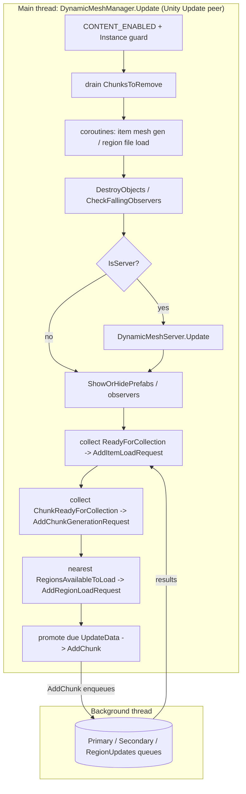
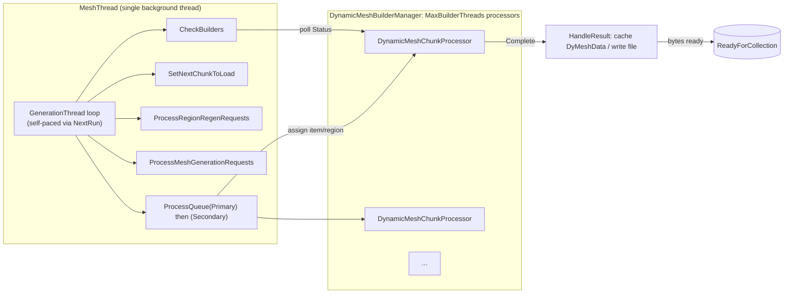
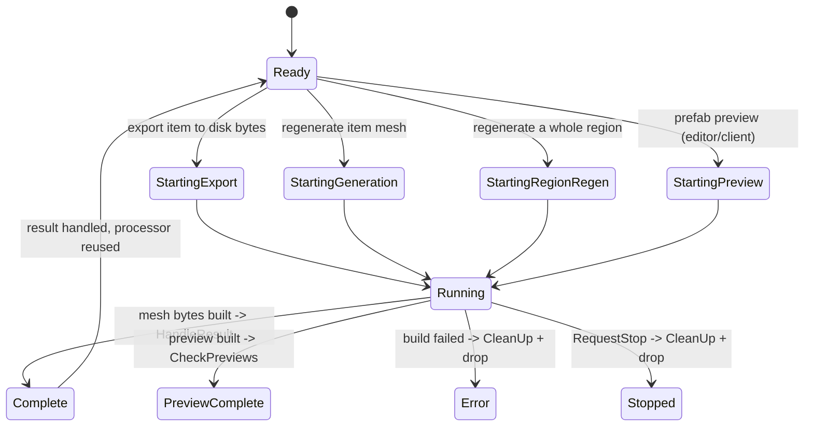
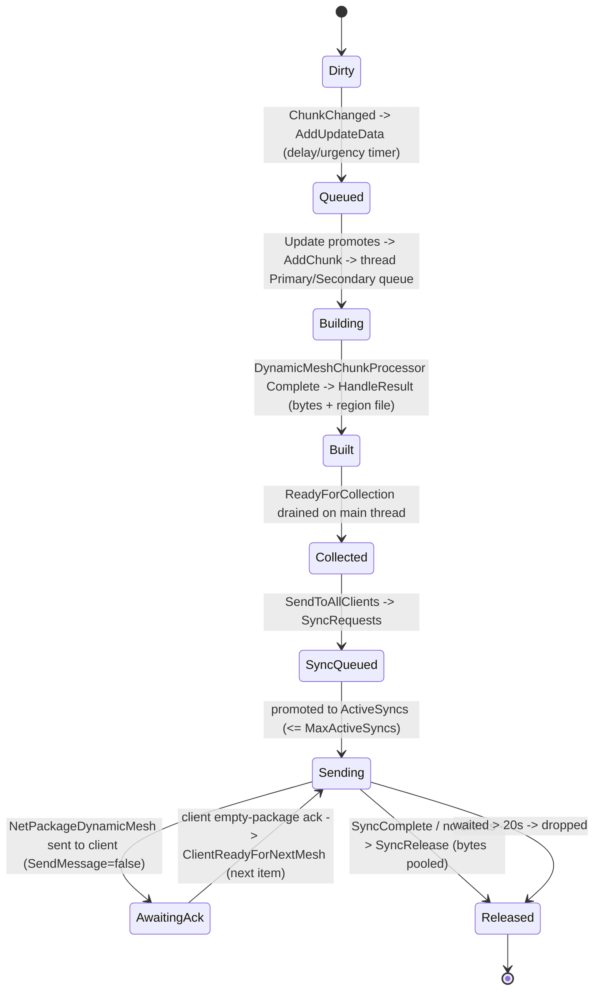

# Dynamic mesh subsystem (dedicated V3.4.0)

**Owns:** the regeneration, persistence, and streaming of deformed and destroyed
block geometry, the geometry that diverges from the base chunk voxel mesh once
players carve, damage, or blow up terrain and structures. In b18 the dedicated
server drove all of it; on V3.4.0 b10 no server path starts or feeds it (§7).
Covers the `DynamicMeshManager` main-thread frame peer, the `DynamicMeshThread`
background generation loop, the `DynamicMeshBuilderManager` worker pool, the
`DynamicMeshServer` send/sync coordinator, on-disk region files, and the two wire
packages (`NetPackageDynamicMesh`, `NetPackageDynamicClientArrive`).
**Not:** the native/Unity `Mesh` and `VoxelMesh` object construction and GPU
upload (client render, residual); the block texture and UV tiling tables
(content); the base chunk terrain mesh and the block store itself (owned by
[`world-chunks.md`](../world/world-chunks.md) and [`save-region.md`](../world/save-region.md)).
**Evidence:** `DynamicMesh*` IL (`DynamicMeshManager` 91 methods,
`DynamicMeshThread` 40, `DynamicMeshFile` 40, `DynamicMeshRegion` 98,
`DynamicMeshServer` + pooled types 35, `DynamicMeshBuilderManager` 18, plus the
two `NetPackage*` bodies; dump locally with `tools/src/DumpMethod`, git-ignored).
**Hub:** [`INDEX.md`](../INDEX.md). **Method:** [`re-methodology.md`](../meta/re-methodology.md).

**V3.4.0 b10 status: still compiled, no longer started or fed by the server.**
Every type, thread, region-file writer, send-loop method and both wire packages
are still in the assembly, and the manager's own bodies are unchanged from b18.
What is gone is every outside caller: the twelve server call sites that dirtied,
saved or tore down the subsystem were deleted, the world-start pref load and
`Init()` call were removed, and `ChunkManager` no longer guards an unload against
the generation thread. No server world path starts the manager, and a manager
started by hand has no edit events to consume. To start
it: a scene `Awake` if a manager component is still placed (residual, §7.1), an
admin `Dynamic mesh` console command, or a runtime pref event the manager's hook
listens for. The sections below describe the subsystem as it exists in the
assembly and as it ran in b18. Read §7 first for what a b10 server does.

In b18 the server owned the regeneration, the disk cache, and the fan-out to
clients; a client only rendered what it was sent (or loaded from its own local
cache). The subsystem is gated by a content flag
(`DynamicMeshManager.CONTENT_ENABLED`) and by `IsValidGameMode`.

---

## 1. The model

When a block is partially damaged or destroyed, the visible surface (a chipped
cube, a hole, a sheared beam, falling debris) no longer matches the clean voxel
mesh the chunk was built with. The dynamic mesh subsystem is a **second geometry
layer** that regenerates only these deformed regions, stores them separately from
the chunk save, and ships them to clients so every peer sees the same damage
without each recomputing it.

The unit hierarchy, all rooted on `DynamicMeshContainer` (which carries a
`Vector3i WorldPosition` and an `Int64 Key`):

| Type | Role |
|---|---|
| `DynamicMeshItem` | one chunk-sized patch of dynamic geometry, keyed by chunk key (`WorldChunkCache.MakeChunkKey`) |
| `DynamicMeshRegion` | a group of items sharing one on-disk file, the load/unload/regen unit |
| `DynamicMeshData` / `DyMeshData` | the raw byte payload a builder produces for one item |
| `DynamicMeshUpdateData` | a pending dirty request with a delay/urgency timer |

`DynamicMeshManager` is a `SingletonMonoBehaviour` (its `Instance` is the live
component). `DynamicMeshThread`, `DynamicMeshBuilderManager`, `DynamicMeshServer`,
and `DynamicMeshFile` are static coordinators it drives. The manager keeps items
in a `ConcurrentDictionary<Int64, DynamicMeshItem> ItemsDictionary` and pending
dirties in `List<DynamicMeshUpdateData> UpdateData`.

In b18, the block edit that started everything was `DynamicMeshManager.ChunkChanged`
(`BlockValueRef`, `entityId`, `blockType`). It filters to valid, non-air block
swaps (`DynamicMeshBlockSwap.IsValidBlock`), and on the server resolves the world
position and calls `AddUpdateData`, which parks a `DynamicMeshUpdateData` in the
`UpdateData` list with a delay. Edits on chunk borders (the low 4 bits of the
position at 0 or 15) additionally dirty the neighbouring chunk so the seam is
regenerated on both sides. V3.4.0 left the method in place
(`il/full-v3.4.0/_global/DynamicMeshManager.il.txt:4389`, `:4397`) but removed
every caller outside the manager and its console command, so this chain has no
server entry point in b10 (§7).

---

## 2. `DynamicMeshManager.Update`: the main-thread frame peer

`DynamicMeshManager.Update` (IL=404) is a **Unity `Update` peer, not called from
`gmUpdate`**. Its absolute order relative to `GameManager.Update` and
`ConnectionManager.Update` is set by Unity script execution order, so treat the
three as peers in the same player-loop phase (see [`loop.md`](../loop/loop.md) §1.1). It
does no mesh math itself; it is the **marshalling point** between the main thread
and the background generation thread. It collects finished work off the thread's
concurrent queues and pushes newly dirtied work down, in this order:

| Step | Work | Structure |
|---|---|---|
| Guard | `CONTENT_ENABLED` and `Instance != null` else return; `time = Time.time` | - |
| 1 | drain chunk removals to `RemoveItem` | `ChunksToRemove` (`ConcurrentQueue<Vector2i>`) |
| 2 | if item load ready or forced-after-delay, coroutine `ProcessItemMeshGeneration` | `ProcessItemLoadReady`, `ForceNextItemLoad` |
| 3 | if region file load requests pending, coroutine `ProcessChunkRegionRequests` | `RegionFileLoadRequests` (`ConcurrentQueue`) |
| 4 | `DestroyObjects`, `CheckFallingObservers` | GameObject teardown, falling-block observers |
| 5 | **if `ConnectionManager.IsServer`, call `DynamicMeshServer.Update`** | the send/sync loop (§5) |
| 6 | observer stop timing; `ShowOrHidePrefabs` + `CheckGameObjects` on `nextShowHide` | prefab visibility |
| 7 | collect built meshes back to main thread | `DynamicMeshThread.ReadyForCollection` (`ConcurrentQueue<DynamicMeshData>`) |
| 8 | collect ready chunk-gen requests | `DynamicMeshThread.ChunkReadyForCollection` (`ConcurrentHashSet<Vector2i>`) |
| 9 | pick nearest loadable region, push a load request to the thread | `RegionsAvailableToLoad` (`LinkedList<Int64>`), `AvailableRegionLoadRequests` budget |
| 10 | promote due dirties from `UpdateData` to `AddChunk` (thread queue) | `UpdateData` (delay/urgency/max-time timers) |

Step 10 is where a dirty becomes real work: each `DynamicMeshUpdateData` fires
when its `UpdateTime` passes, or immediately if `IsUrgent`, or at latest when its
`MaxTime` is reached, and `AddChunk(key, addToThread, primary, region)` hands it
to the background thread. Steps 7 and 8 pull the results back. The whole method
is lock-light: cross-thread handoff uses `ConcurrentQueue` / `ConcurrentHashSet`, and
the main thread only touches Unity objects (coroutines, GameObjects, `Time.time`).
The method itself is unchanged in b10 (`IL=404`,
`il/full-v3.4.0/_global/DynamicMeshManager.il.txt:3550`) and still runs the
`IsServer` branch that calls `DynamicMeshServer.Update`
(`il/full-v3.4.0/_global/DynamicMeshManager.il.txt:3639`), but only while a
manager component exists and is enabled; a stock b10 world load does not create
the entry point (§7).

---

## 3. Threading: one generation thread, a pool of builders

Generation runs entirely off the main thread on a **single dedicated worker
thread** plus a **pool of builder threads**.

`DynamicMeshThread.StartThread` creates one `System.Threading.Thread`
(`MeshThread`) whose body waits (100 ms sleeps) for `GameManager` and `World` to
come up, then loops `while (!RequestThreadStop) GenerationThread()`.
`GenerationThread` **self-paces** with a `NextRun` timestamp: it sleeps to
`NextRun` if it is in the future, backs off 500 ms when the manager is null or
paused, and 300 ms when every queue is empty, otherwise it runs one pipeline pass:

1. `HandleRegionLoads`, then `DynamicMeshBuilderManager.CheckBuilders`.
2. If a builder thread is available and there is queued work: `SetNextChunkToLoad` (feeds `nextChunks` for `GetNextChunkToLoad` / GenerateChunksThread),
   `ProcessRegionRegenRequests`, `ProcessMeshGenerationRequests`.
3. Drain `PrimaryQueue` then `SecondaryQueue` via `ProcessQueue`
   (`ConcurrentDictionary<Int64, DynamicMeshItem>` each), staging chunks for build.

The heavy voxel-to-geometry work is done by `DynamicMeshBuilderManager`, which
starts `MaxBuilderThreads` `DynamicMeshChunkProcessor` threads. The count is
`min(max(SystemInfo.processorCount - 2, 1), 8)` then further clamped to
`DynamicMeshSettings.MaxDyMeshData + 1` (`SetDefaultThreads`). Each processor
takes an item or region, builds the mesh bytes, and exposes a `Status`. The
generation thread polls them in `CheckBuilders`.

### 3.1 Builder processor lifecycle

`DynamicMeshChunkProcessor.Status` is a `DynamicMeshBuilderStatus` enum. The
generation thread advances a processor from `Ready` into one of the four start
states, waits while it is `Running`, and reacts to the terminal states in
`CheckBuilders`: `Complete` triggers `HandleResult`, while `Stopped` and `Error`
trigger `CleanUp` and removal from the pool.

`HandleResult` is where a finished build becomes a sendable/persistable payload.
On a dedicated server it caches the produced `DyMeshData` bytes (`DyMeshData.AddToCache`)
rather than instantiating a renderable Unity `Mesh`; the item key is then surfaced
to the main thread through `ReadyForCollection` for the server to send.

**Load-request and copy helpers:** `DyMeshRegionLoadRequest.CreateMeshSync`
(IL=52) builds the client-side region GameObject: it pools a mesh-renderer
GameObject named `"R:" + region.ToDebugLocation()` at the origin (inactive),
fills `OpaqueMesh` via `CreateOpaqueMeshSync` and `TerrainMesh` via
`CreateTerrainGoSync`, each budgeted by
`DynamicMeshSettings.MaxRegionLoadMsPerFrame`, then installs
`RegionObject`, sets `IsMeshLoaded = true`, repositions the region and
`SetVisibleNew(VisibleChunks != 0 && !InBuffer, "create mesh sync
finished", true)`.
`DynamicMeshVoxelLoad.CopyTerrain(terrain, mesh, filter, timing, item)`
(IL=209) is the voxel-mesh-to-Unity copy job: `MeshUnsafeCopyHelper` copies
vertices / uv / uv2 / uv3 / uv4 / colors, each stage timed into `MeshTiming`
(CopyVerts, CopyUv..CopyUv4, CopyColours); triangles copy through
`CopyTriangles` with per-`TerrainSubMesh` submeshes when the main index list
is empty; normals copy or fall back to `Mesh.RecalculateNormals`; then
`GameUtils.SetMeshVertexAttributes(mesh, true)` and `UploadMeshData(false)`.
Materials come from the `DynamicMeshFile.TerrainSharedMaterials` cache keyed
by submesh count, built from `MeshDescription.meshes[5].material` (see the
[light-mesh-water.md](../world/light-mesh-water.md) §3 terrain-mesh note).

---

## 4. Region persistence

Dynamic meshes are saved **outside the chunk region files**, in their own
directory. If a manager component is in the scene, `DynamicMeshManager.Awake`
(IL=174, `il/full-v3.4.0/_global/DynamicMeshManager.il.txt:790`) sets
`DynamicMeshFile.MeshLocation` to
`GameIO.GetSaveGameDir() + "/DynamicMeshes/"` on the server (and
`GetSaveGameLocalDir() + "/DynamicMeshes/"` on a client, which caches what it is
sent). File naming is derived from the region/chunk key:

| File | Path | Producer (live) |
|---|---|---|
| Region group | `<MeshLocation><key>.group` | `DynamicMeshRegion.Path` (path); written by `DynamicMeshRegionDataStorage.SaveRegion` |
| Region raw | `<MeshLocation><key>.raw` | `DynamicMeshRegionDataWrapper.RawPath` |
| Per-item mesh | `<MeshLocation><X>,<Z>.mesh` | client `NetPackageDynamicMesh.read` cache path |

**Live save path (deflate-compressed, no version tag).** Persistence is driven by
`DynamicMeshChunkProcessor.RegenerateRegion -> DynamicMeshRegionDataStorage.SaveRegion(region, worldPos, opaque, terrain)`.
`SaveRegion` (IL=69) opens `DynamicMeshRegionDataWrapper.Path()` (the `.group` file)
via `SdFile.Open`, wraps it in a `Noemax.GZip.DeflateOutputStream` (IL_0032), then
calls `DynamicMeshVoxelRegionLoad.SaveRegionToFile(bw, ...)` (IL=7), which is just
`WriteOpaqueMesh(bw, opaque)` followed by `WriteTerrainVoxelMeshesToDisk(bw, terrain)`.
There is **no version-`160` tag and no chunk-position table** in the live format;
the stream is deflate-compressed opaque-mesh + terrain-mesh payload. Per-item chunk
metadata is serialized by `DynamicMeshChunkData.Write` (IL=201): `X:i32, OffsetY:i32,
Z:i32, EndY:i32, MinTerrainHeight:i32, ...` then packed `byte`/`i32` fields, `UpdateTime:u32`,
a trailing `i64`, and `ChunkNeighbourData.Write`.

**Read side:** `DynamicMeshRegionDataStorage.LoadRegion` (IL=167) opens the file via
`SdFile.OpenRead` and calls `DynamicMeshVoxelRegionLoad.LoadRegionFromFile`. The
"`Deleting corrupted file.`" log lives in `LoadRegion`; the "`Corrupted region.
Adding for regen`" log is `DynamicMeshRegion.OnCorrupted`. On a headless server the
byte-level load is what matters, the actual `Mesh`/GameObject build is client render.

**Regen bookkeeping (`ThreadRegeneratingData`):** `ChunkManager` snapshots
`viewingChunkPositionsCopy` / `collisionChunkPositionsCopy` for a
regenerating chunk - the two position sets (the viewers' seen range and the
collision range) the regeneration pass re-checks before deciding a chunk
really needs rebuilding.

**Chunk-data access layer:** `DynamicMeshChunkDataWrapper` is the locked
handle to a chunk's `DynamicMeshChunkData` on the generation threads:
`TryGetData(out data, debug)` (IL=15) is `TryTakeLock(debug)` then out the
`Data` (null + false when the lock is held elsewhere); `GetLock` (IL=73) /
`ReleaseLock` (IL=4) / `ThreadHasLock` (IL=4) and `IsReadyForRelease`
(IL=49) manage the lifecycle, while `Path` (IL=13) / `RawPath` (IL=13) /
`Exists` (IL=4) give the on-disk file handles; `Reset` (IL=4) drops the
payload for reuse.

**The chunk-data queue (`DynamicMeshChunkDataStorage<T>`):** the generic
storage behind `DynamicMeshThread.ChunkDataQueue` (a
`DynamicMeshChunkDataStorage<DynamicMeshItem>`). The generation thread uses
`IsUpdating` / `MarkAsUpdating` / `MarkAsUpdated` / `MarkAsGenerating`
(IL=11-15 each) to track per-item load/generate state, `ClearQueues`
(IL=15) / `IsReadyThreaded` (IL=13) for shutdown pacing, and
`TryLoadItem(wrapper, releaseLock)` (IL=192) for the disk-read path: it
takes the wrapper's lock, reads the chunk bytes (`Stream.ReadByte` /
`PooledBinaryWriter.SetBaseStream` decode into `DynamicMeshChunkData`),
then `TryExit` / `ReleaseLock` under the wrapper's lock discipline.

**Dead legacy path (not executed from live producers).** `DynamicMeshFile.WriteRegion`
(IL=159) / `WriteRegionHeaderData` (IL=133) / `Write16BitVoxelMeshes` /
`LoadRegionGameObjectSync` are an older version-`160` region format. On V3.2.0 b9,
`tools/bin/Xref.exe` reports **exactly one** call site for `WriteRegion` and for
`WriteRegionHeaderData`: each method's own catch-path **self-retry** (`tryCount++`,
`Thread.Sleep`, recurse). There is **no external caller** from
`RegenerateRegion` / `SaveRegion` / manager Update. Live persistence is only the
`SaveRegion` deflate path above. Do not implement a clone against the version-160
writers. (For the record the dead `WriteRegion` body still contains the old field
layout and retry guards 5 / 10, but nothing outside the method invokes it.)

**Dead generic template:** `DynamicMeshDataQueue<T>` (38 methods) is a
load/save/cache lifecycle queue (`AddSaveRequest`, `TryLoadItem`, `SaveItem`,
`ReleaseBytes`, `TryGetData`, byte accounting via `MBytesLive` /
`MBytesReleased`, pooling, `LogMemoryUsage`). `tools/bin/RefScan.exe` reports
**0 external references** on b9: nothing instantiates or calls it. The live
queue is the `DynamicMeshChunkDataStorage<T>` described above
(`DynamicMeshThread.ChunkDataQueue`); do not treat the dead template as the
storage contract.

**Inert server-update channel:** `DynamicMeshThread.ServerUpdates`
(`Queue<DynamicMeshServerUpdates>`) is the pooled per-chunk update record
(chunk X/Z, `StartY`/`EndY`, deflated `Bytes`, `UpdateTime`, with
`WriteAir` / `WriteEmptyLayer` / `WriteLayer` / `WriteBinaryBlock` writers).
`AddChunkUpdateFromServer(data)` (IL=15) enqueues into it, but the method
has **0 external call sites on b9** and nothing in the generation loop ever
dequeues the queue, so even a produced record would sit unprocessed. Treat
the channel as inert in this build (re-meshing of server block changes flows
through the normal `PrimaryQueue`/`SecondaryQueue` staging instead).

**Dead region-builder wrapper:** `DynamicMeshRegionBuilder` (4 methods:
`AddNewItem`, `StartThread`, `RequestStop`, `get_world`; fields `Status` /
`Result` / `Region` / `thread`) has **0 external references on b9** (both
RefScan and signature scan); the live region-regen path runs inside the
`DynamicMeshChunkProcessor` pool described above.

---

## 5. Streaming to clients

Sending is the server-only half, driven from `DynamicMeshServer.Update` (IL=452),
which the manager calls in step 5 of its frame only when `ConnectionManager.IsServer`.
The send loop is intact in b10, but it runs only while the manager ticks, and a
stock b10 server does not start one (§7).

### 5.1 Wire packages

The heavy payload package rides **channel 1** (the bulk terrain/map band) while
the client inventory package rides channel 0, and **both are LZ-compressed**; see
[`protocol-packages.md`](../network/protocol-packages.md) §1.1 and §1.2 and
[`network.md`](../network/network.md).

`NetPackageDynamicMesh` (Channel **1**, Compress **1**, Direction **Both**,
`MaxMessageSize` 2 MiB). The `write` body, authoritative for byte order:

| Order | Field | Width | Note |
|---|---|---|---|
| 1 | `X` | `i32` | region/item world X |
| 2 | `Z` | `i32` | region/item world Z |
| 3 | `UpdateTime` | `i32` | version stamp used for dedup |
| 4 | `len` | `i32` | payload length (`PresumedLength`, clamped) |
| 5 | `bytes` | `len` bytes | the compressed mesh payload |

`read` mirrors this. Because the direction is `Both`, the same package type flows
both ways: server to client it carries the mesh body; **client to server it is the
empty acknowledgement** that drives flow control. `NetPackageDynamicMesh.ProcessPackage`
branches on `IsServer`: on the server an inbound package means "client ready for
next" (`ClientReadyForNextMesh`); on the client a valid update calls
`AddDataFromServer(X, Z)` to load the freshly received mesh, then sends an empty
`NetPackageDynamicMesh` back to the server as the ack.

`NetPackageDynamicClientArrive` (Channel **0**, Compress **1**, Direction
**ToServer**). On connect the client enumerates every dynamic mesh item it already
holds and sends `count` then per item `X:i32, Z:i32, UpdateTime:i32`. The server
(`ClientMessageRecieved` -> `DynamicMeshClientConnection.UpdateItemsToSend`)
reconciles those `UpdateTime` stamps against its own, so it only streams meshes the
client is missing or has a stale version of. This is the "I have arrived, here is
my inventory, send me the deltas" handshake.

### 5.2 The server send loop

`DynamicMeshServer` keeps a `Dictionary<entityId, DynamicMeshClientConnection>`
(`ClientData`, maintained by `OnClientConnect` / `OnClientDisconnect`). A completed
mesh enters the pipeline via `SendToAllClients(item, isDelete)`, which enqueues a
`DynamicMeshSyncRequest` on the `SyncRequests` `ConcurrentQueue`. Each
`DynamicMeshServer.Update`:

1. Drains `SyncReleaseQueue`, marking the matching `ActiveSyncs` entry
   `SyncComplete` and returning its pooled bytes.
2. Promotes queued `SyncRequests` into `ActiveSyncs` up to `MaxActiveSyncs` (10),
   stamping `Initiated`.
3. Walks `ActiveSyncs`: an entry that is `SyncComplete` or has no clients is
   released and removed; otherwise, if it `HasData` (or `TryGetData` loads it), it
   builds a `NetPackageDynamicMesh` via `Setup(item, data)`, sets `PresumedLength`,
   and `SendPackage`s it to the target client (or all clients when `ClientId == -1`).
   An entry waiting more than 20 s is dropped with a warning.
4. Per client, `ItemsToSend` is a `ConcurrentDictionary<(X,Z), ConcurrentQueue<SyncRequest>>`
   keyed by region. The server picks the region **nearest the player**
   (`OrderBy` distance), dequeues its next item, re-enqueues it to `SyncRequests`,
   and records `LastSend`. A per-client `SendMessage` / `TriggerSend` flag gates
   whether the next item may go out.

Flow control is the `SendMessage` flag: it is only set true again when the client
returns its empty `NetPackageDynamicMesh` ack (`ClientReadyForNextMesh`), so the
server sends at most one outstanding mesh per client at a time and never floods a
joining client that is downloading a large deformed area.

---

## 6. Dedicated relevance: the b18 model and residuals

- **In b18, authority and save ran on the server.** The generation thread, the
  builder pool, the `DynamicMeshes/` disk cache, and the `DynamicMeshServer`
  send/sync loop were all server-side. The `IsServer` branch in
  `DynamicMeshManager.Update` is what activates the send half; a client only
  receives, caches, renders, and acks. V3.4.0 removed the inputs, the teardown
  and the startup, which is the subject of §7.
- **Client-only gates (IL-verified):** `AddRegionLoadMeshes(key)` (IL=27)
  begins with `if (GameManager.IsDedicatedServer) return;` - the region-mesh
  load-queue add is client-only; `CreateUnityTerrainOld` (IL=961, the Unity
  terrain builder) and the `create*` environment creators are likewise client
  renderer surface.
- **Two independent stores.** Dynamic meshes live in their own `DynamicMeshes/`
  directory keyed by chunk key, separate from the chunk region save
  ([`save-region.md`](../world/save-region.md)). Deleting a `.group` file loses that
  region's deformation geometry (regenerated on next edit), not the blocks
  themselves, which are authoritative in the chunk store.
- **Residual (native / client render).** The actual Unity `Mesh` / `VoxelMesh`
  construction, vertex/normal/UV math, GPU upload, LOD and imposter rendering, and
  the `CreateMeshObject` GameObject path are client render. On a headless server the
  build produces and caches serialized byte payloads (`DyMeshData`) and never
  instantiates renderable meshes (consistent with `CopyChunksToUnity` being skipped
  on dedicated, [`loop.md`](../loop/loop.md) phase H).
- **Residual (content).** Block texture indices and UV tiling tables consumed by
  the mesh writers come from block data, not from these method bodies.
- **Compression codec.** The channel-1 payload compression flag is known; the
  codec is the **managed Noemax.GZip deflate** (`NetConnectionAbs.Compress`
  IL=59, level 3 raw deflate - same as the region payload, byte-exact-verified;
  [protocol-packages.md](../network/protocol-packages.md) §1.2).

## 7. V3.4.0 b10: the subsystem is inert

The removal is a set of deleted call instructions. `DynamicMeshManager`'s own
method list and bodies did not change (`Update` IL=404,
`il/full-v3.4.0/_global/DynamicMeshManager.il.txt:3550`; `ChunkChanged` IL=112 at
`:4397`). The twelve b18 server call sites and their b10 state:

| Site | b18 call | b10 state |
|---|---|---|
| `Block.OnBlockDamaged` | `ChunkChanged` twice (damage, downgrade), `il/full-v3.3.0/_global/Block.il.txt:4612`, `:4661` | IL=487, call gone (`il/full-v3.4.0/_global/Block.il.txt:4460`) |
| `Block.OnBlockPlaceBefore` | `ChunkChanged`, `il/full-v3.3.0/_global/Block.il.txt:5682` | IL=96, call gone (`il/full-v3.4.0/_global/Block.il.txt:5660`) |
| `World.AddFallingBlock` | `AddFallingBlockObserver`, `il/full-v3.3.0/_global/World.il.txt:7401` | IL=36, call gone (`il/full-v3.4.0/_global/World.il.txt:7373`) |
| `World.LetBlocksFall` | `ChunkChanged` per falling block, `il/full-v3.3.0/_global/World.il.txt:7555` | IL=215, call gone (`il/full-v3.4.0/_global/World.il.txt:7411`) |
| `World.CreateFallingBlockGroup` | same, `il/full-v3.3.0/_global/World.il.txt:7967` | IL=102, call gone (`il/full-v3.4.0/_global/World.il.txt:7922`) |
| `NetPackageSetBlock.ProcessPackage` | `ChunkChanged` per change, `il/full-v3.3.0/_global/NetPackageSetBlock.il.txt:128` | IL=34, call gone (`il/full-v3.4.0/_global/NetPackageSetBlock.il.txt:100`) |
| `ConsoleCmdChunkReset/<execute>d__5` | `AddChunk` per reset chunk, `il/full-v3.3.0/_global/ConsoleCmdChunkReset__execute_d__5.il.txt:296`, `:808` | call gone |
| `GameManager.SaveAndCleanupWorld` | `OnWorldUnload()`, `il/full-v3.3.0/_global/GameManager.il.txt:3583` | IL=501, and the type has no `DynamicMesh` reference at all (`il/full-v3.4.0/_global/GameManager.il.txt:3236`) |
| `GameManager.SetBlockTextureClient` | `ChunkChanged`, `il/full-v3.3.0/_global/GameManager.il.txt:10525` | IL=80, call gone (`il/full-v3.4.0/_global/GameManager.il.txt:10520`) |
| `Origin.DoReposition` | `OriginUpdate`, `il/full-v3.3.0/_global/Origin.il.txt:268` | IL=185, call gone (`il/full-v3.4.0/_global/Origin.il.txt:90`); `FixedUpdate` returns on dedicated (`:445`) |
| `UnityDistantTerrain.BuildAroundPos` | `UpdateDistantTerrainBounds`, `il/full-v3.3.0/_global/UnityDistantTerrain.il.txt:984` | IL=486, call gone (`il/full-v3.4.0/_global/UnityDistantTerrain.il.txt:494`) |
| `DynamicObserver.HasFallingBlocks` | `Chunk.HasFallingBlocks` + `AddUpdateData`, `il/full-v3.3.0/_global/DynamicObserver.il.txt:124`, `:133` | IL=45, only the "chunk failed to load" path (`il/full-v3.4.0/_global/DynamicObserver.il.txt:87`) |

Consequently, in b10 the only `ChunkChanged` callers are the manager itself and
the `Dynamic mesh` console command (`il/full-v3.4.0/_global/DynamicMeshConsoleCmd.il.txt:609`;
`il/full-v3.4.0/_global/DynamicMeshManager.il.txt:752`). `AddFallingBlockObserver`,
`OriginUpdate`, `UpdateDistantTerrainBounds` and `AddUpdateData` have no caller
outside the manager. `NetPackageRegionMetaData.ProcessPackage` still calls
`GetRegion`/`AddChunk` (`il/full-v3.4.0/_global/NetPackageRegionMetaData.il.txt:88`,
`:125`), but that is the dynamic-mesh wire family reconciling client inventory,
gated on `CONTENT_ENABLED` and a live `Instance`.

### 7.1 Startup and settings

In b18 the world-load coroutine read the whole pref block into the settings
object, logged `Loading dymesh settings`, and called `Init()` when running as
server (`il/full-v3.3.0/_global/GameManager__startGameCo_d__139.il.txt:346`-`:373`):
203 into `CONTENT_ENABLED`, 205 `OnlyPlayerAreas`, 207 `UseImposterValues`,
204 `MaxViewDistance`, 206 `PlayerAreaChunkBuffer`, 208 `MaxRegionMeshData`,
209 `MaxDyMeshData`, then `DynamicMeshSettings.LogSettings()`. The b10
`startGameCo` body contains no `GamePrefs::GetBool` call
(`il/full-v3.4.0/_global/GameManager__startGameCo_d__139.il.txt:16`, IL=350), and
the `Loading dymesh settings` string appears nowhere in the b10 assembly. The
`worldInfoCo` coroutine also no longer calls `Init()` (b18:
`il/full-v3.3.0/_global/GameManager__worldInfoCo_d__198.il.txt:715`; b10: no
`DynamicMeshManager::Init` reference in that type).

`DynamicMeshSettings` statics therefore keep their `.cctor` values
(`il/full-v3.4.0/_global/DynamicMeshSettings.il.txt:54`): `MaxRegionMeshData` 1,
`MaxRegionLoadMsPerFrame` 2, `MaxDyMeshData` 3, `UseImposterValues` true,
`OnlyPlayerAreas` false, `PlayerAreaChunkBuffer` 3, `MaxViewDistance` 1000. The
only pref still applied to these statics is 204, through `OnGamePrefChanged`
(`il/full-v3.4.0/_global/DynamicMeshSettings.il.txt:77`, and the hook is
registered in the `.cctor` at `:72`).

`Init()` (IL=12, `il/full-v3.4.0/_global/DynamicMeshManager.il.txt:4111`) reads
pref 203, disables the imposter shader keyword and restarts
`DelayStartForWorldLoad`. Its b10 callers are the console `restart` subcommand
(`il/full-v3.4.0/_global/DynamicMeshConsoleCmd.il.txt:1693`) and
`EnabledChanged` (`il/full-v3.4.0/_global/DynamicMeshManager.il.txt:43`, call at
`:60`), which is itself called by the console `toggle` subcommand
(`il/full-v3.4.0/_global/DynamicMeshConsoleCmd.il.txt:1604`) and by the manager's
pref hook, which compares the incoming pref against the literal 45
(`il/full-v3.4.0/_global/DynamicMeshManager.il.txt:186`). No world-start path
calls it.

### 7.2 The unload guard

In b18, the server-only unload sweep in `ChunkManager.DetermineChunksToLoad`
skipped a chunk as an unload candidate while the dynamic-mesh thread still held
it: `DynamicMeshThread.ChunksToProcess` and `DynamicMeshThread.ChunksToLoad`
checks at `il/full-v3.3.0/_global/ChunkManager.il.txt:2720`, `:2724`. Both are
gone from the b10 body (IL 456 -> 448,
`il/full-v3.4.0/_global/ChunkManager.il.txt:2345`), and
`FreeChunkGameObject(ChunkCluster, Int64)` lost its
`DynamicMeshThread.RemoveChunkGameObject` call (IL 44 -> 42; b18
`il/full-v3.3.0/_global/ChunkManager.il.txt:3370`; b10 header
`il/full-v3.4.0/_global/ChunkManager.il.txt:3360`). A chunk can now be released
on the main thread while the generation thread holds its key, the ordering the
guard existed to prevent. The race only fires if the manager is running, which
on b10 is opt-in.

### 7.3 What still exists, and what would start it

The assembly still contains the manager and its `Update` peer (IL=404), the
single generation thread, the builder pool, the region file code, the
`DynamicMeshServer` send loop (still called from `DynamicMeshManager.Update` at
`il/full-v3.4.0/_global/DynamicMeshManager.il.txt:3639`), both wire packages, and
the console command registered as `Dynamic mesh` with subcommand `zz`
(`il/full-v3.4.0/_global/DynamicMeshConsoleCmd.il.txt:3960`, `:4020`). Starting
it takes one of:

- an admin `Dynamic mesh` console command: `restart` calls
  `OnWorldUnload()` then `Init()` (`il/full-v3.4.0/_global/DynamicMeshConsoleCmd.il.txt:1689`-`:1693`),
  and `toggle` flips pref 203 and calls `EnabledChanged`
  (`il/full-v3.4.0/_global/DynamicMeshConsoleCmd.il.txt:1592`-`:1604`);
- a runtime pref event the manager's hook accepts
  (`il/full-v3.4.0/_global/DynamicMeshManager.il.txt:184`-`:190`);
- a scene `Awake`, if a `DynamicMeshManager` component is still placed in the
  world scene. The IL cannot show scene composition.

**Residual (not decoded): scene placement.** `Awake` (IL=174,
`il/full-v3.4.0/_global/DynamicMeshManager.il.txt:790`) reads pref 203 into
`CONTENT_ENABLED` and, when enabled, calls `LoadItemsDedicated` synchronously.
Nothing in the assembly proves whether a manager component is in the b10 world
scene. Settle it on a live server with `DynamicMeshEnabled=1`: look for `Awake`,
`Mesh location:` and `Loading all items took:` at world start, and compare with
a b18 log for `Loading dymesh settings`.

**Residual (not decoded): compensation.** `DynamicMeshManager.Update` and
`DynamicMeshThread` were not re-read line by line; their body hashes are
unchanged, which argues no new dirty scan was added. Settle it by carving a
block on a b10 server with dynamic mesh enabled and checking whether a region
file under `DynamicMeshes/` is rewritten.

---

## Related docs

| Doc | Role |
|---|---|
| [loop.md](../loop/loop.md) | Frame peers; `DynamicMeshManager.Update` is a Unity Update peer, not under `gmUpdate` |
| [network.md](../network/network.md) | Channel bands; `NetPackageDynamicMesh` on the dynamic mesh server |
| [protocol-packages.md](../network/protocol-packages.md) | Channel-1 set and the compressed-package set this belongs to |
| [world-chunks.md](../world/world-chunks.md) | The base chunk mesh and block store the dynamic layer diverges from |
| [save-region.md](../world/save-region.md) | Chunk region files, separate from the `DynamicMeshes/` cache |
| [re-methodology.md](../meta/re-methodology.md) | How this was reversed |

## Changelog

- **2026-11-05 (V3.4.0 b10 retarget):** the subsystem is inert on a dedicated
  server. Twelve b18 server call sites were removed (block damage and placement,
  world falling blocks, `NetPackageSetBlock`, `chunkreset`, `SaveAndCleanupWorld`,
  `SetBlockTextureClient`, `Origin`, distant terrain, `DynamicObserver`), prefs
  203-209 are no longer loaded at world start, `Init()` is reachable only from the
  `Dynamic mesh` console command and the pref hook, and `ChunkManager`'s unload
  guard lost its dynamic-mesh-thread checks. Manager bodies are unchanged.
- **2026-10-24:** Retargeted to V3.3.0 (b18). No `DynamicMesh*` type, signature or
  body changed. The only delta in this subsystem is that
  `NetPackageDynamicMesh` and `NetPackageDynamicClientArrive` lost their
  `GetLength()` helper (a length estimate, not serialized), so both wire bodies
  read and write exactly as documented.
- **2026-08-11:** Dynamic-mesh IL re-verified: Update IL=404, CreateMeshSync IL=52, CopyTerrain IL=209, SaveRegion IL=69, SaveRegionToFile IL=7, ChunkData.Write IL=201, LoadRegion IL=167, TryGetData IL=15, GetLock IL=73, ReleaseLock/ThreadHasLock IL=4, IsReadyForRelease IL=49, Path/RawPath IL=13, Exists IL=4, Reset IL=4, IsUpdating/MarkAsUpdating/MarkAsUpdated/MarkAsGenerating IL=11-15, ClearQueues IL=15, IsReadyThreaded IL=13, TryLoadItem IL=192, DynamicMeshFile.WriteRegion IL=159 / WriteRegionHeaderData IL=133, AddChunkUpdateFromServer IL=15, DynamicMeshServer.Update IL=452 (exact).
- **2026-08-10:** Dynamic-mesh IL re-verified: DynamicMeshManager.Update IL=404, DynamicMeshRegionDataStorage.SaveRegion IL=69, SaveRegionToFile IL=7, DynamicMeshChunkData.Write IL=201 (exact).
- **2026-08-10:** `MaxActiveSyncs` default verified = **10** (`ldc.i4.s 10` +
  `stsfld` in the `DynamicMeshServer` static ctor), console-settable
  (`activesyncs` param, DynamicMeshConsoleCmd IL_0BB2). Matches the doc's
  budget claim and the optimizer's 2-vs-10 audit.
- **2026-08-08:** DynamicMeshDataQueue<T> dead template, inert ServerUpdates channel, DynamicMeshRegionBuilder dead wrapper (all 0-ref verified).
- **2026-07-28:** `GetNextChunkToLoad` queue sentinel contract for GenerateChunksThread.

- **2026-07-23:** Initial dynamic mesh reversal: the item/region model, the
  `DynamicMeshManager.Update` main-thread marshalling peer, the single generation
  thread plus builder-processor pool and status lifecycle, region file persistence
  (`.group`/`.raw`/`.mesh`, version 160), and the server send/sync loop with
  `NetPackageDynamicMesh` (channel 1, compressed, Both) flow control and
  `NetPackageDynamicClientArrive` reconciliation.
