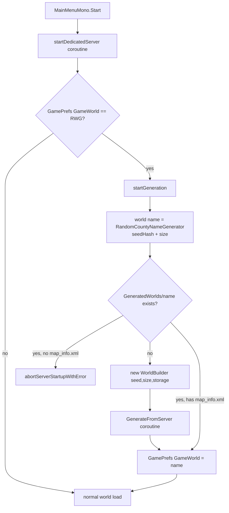
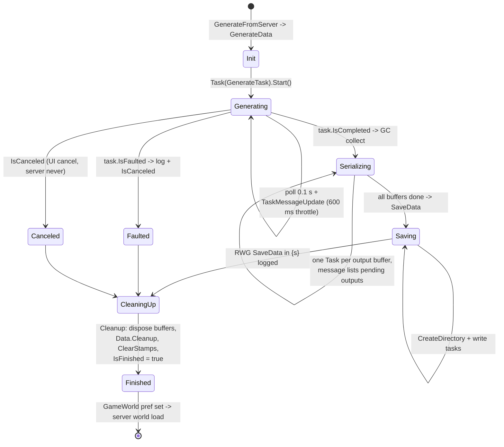
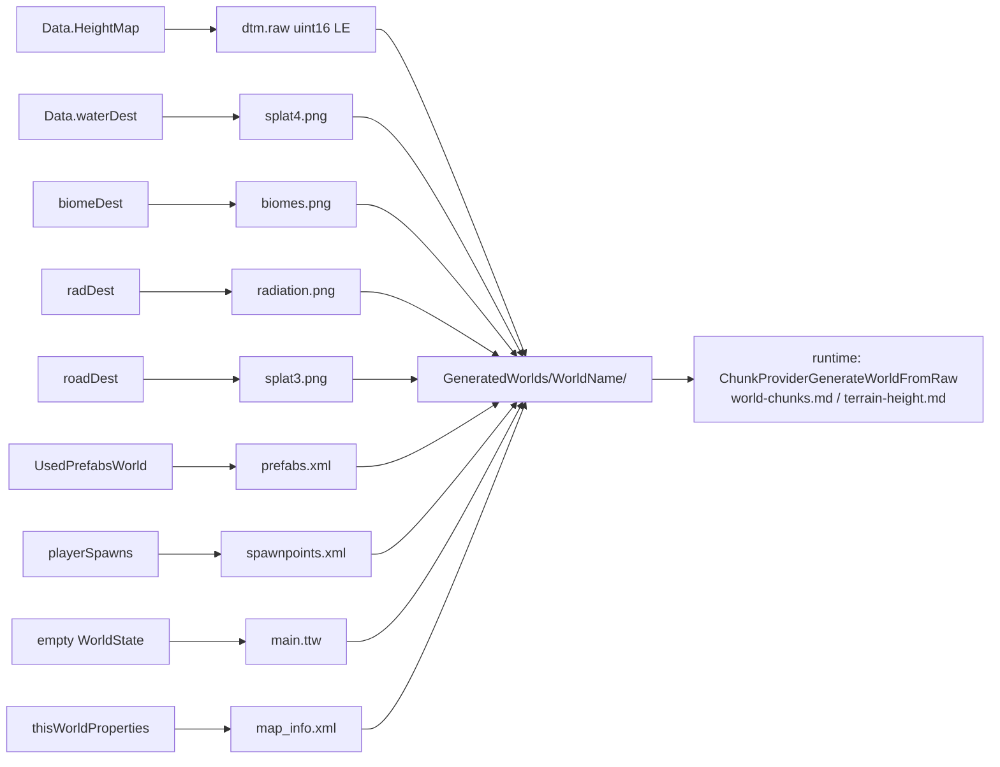

# World generation / RWG (dedicated V3.2.0)

**Owns:** the `WorldGenerationEngineFinal.*` surface: the random world generation
(RWG) pipeline a dedicated server runs at world creation. Generator driver
(`WorldBuilder`), stage order (biomes, terrain tiles, stamps, towns, wilderness,
highways, roads, water), threading, progress/lifecycle, and the on-disk world
artifacts. Plus the `PrefabVolumes.*` marker/volume model where generation uses
it, and the `SDF.*` settings format that feeds the generation parameters.
**Not:** the runtime chunk/terrain path that consumes the generated world
([`world-chunks.md`](../world/world-chunks.md), [`terrain-height.md`](../world/terrain-height.md));
region saves ([`save-region.md`](../world/save-region.md)); rwgmixer/prefab XML content
semantics (data, not loop IL).
**Evidence:** `WorldGenerationEngineFinal.*` IL (64 types / 489 method bodies),
`PrefabVolumes.*` (16 / 158), `SDF.*` (12 / 49); dump locally with
`tools/src/DumpAll` (git-ignored). **Hub:** [`INDEX.md`](../INDEX.md).
**Method:** [`re-methodology.md`](../meta/re-methodology.md).

This is a world-create-only codepath: it runs once when a dedicated server is
asked to host an RWG world whose folder does not exist yet, then never again for
that world. Nothing here is per-tick cost.

---

## 1. Dedicated entry: when generation runs

`MainMenuMono.Start` drives dedicated startup as a coroutine chain:
`startDedicatedServer` reads `GamePrefs.GameWorld` (enum 33); when it equals
`"RWG"` it enters `startGeneration(_worldStorageType, _finishedCallback)`.
That coroutine reads `WorldGenSeed` (171) and `WorldGenSize` (172), computes the
generated world name, and resolves it against `PathAbstractions.WorldsSearchPaths`:

- **Folder absent:** construct `new WorldBuilder(seed, size, storage)` and yield
  `GenerateFromServer()` (the full pipeline below). Afterwards `GameWorld` (33)
  is set to the generated name and server startup continues into normal world
  load.
- **Folder present with `map_info.xml`:** reuse it (no generation).
- **Folder present but no `map_info.xml`:** abort startup with the
  "world likely was never successfully generated" error.

World identity is deterministic:
`WorldBuilder.GetGeneratedWorldName = RandomCountyNameGenerator.GetName(seedName.GetHashCode() + worldSize)`
and the output folder is
`GameIO.GetUserGameDataDir(storage) + "/GeneratedWorlds/<WorldName>/"`
(`GetWorldPath`, IL=7). The numeric seed used everywhere is
`Seed = WorldSeedName.GetHashCode() + WorldSize` (set in `Init`), pushed into the
`Rand` singleton (`Rand.SetSeed`); stage logs print `r={x}` from

**Live-verified 2026-08-12 (RWG 4096, seed `rwtprobe`):** the pipeline produced
`GeneratedWorlds/Bogexe Valley/` (county-name generator) containing
`biomes.png`, `dtm.raw`, `dtm_processed.raw`, `main.ttw` (a pristine **264 B**
header: `V 3.2.0 (b9)` VI (1,3,10,14), waterLevel 62.88, providerId 4, seed 0 -
byte-exact via `save_roundtrip_check.py --shipped`), `map_info.xml`,
`prefabs.xml`, `radiation.png`, and the splash PNGs. `createWorld() done` ~53 s
after boot (4096; the world then generates chunks on demand).
`Rand.PeekSample()` so a run's determinism is checkable in the log.



`GenerateFromUI` / `FinishForPreview` are the client-editor variants of the same
driver (they attach a `XUiC_WorldGenerationPreview`); on the server
`PreviewWindow` is null and all progress goes to the log only.

---

## 2. The builder and its state

`WorldBuilder` (116 fields / 97 methods / 7090 IL, the namespace's largest type)
is a one-shot object holding the entire generation state:

| State | Content |
|---|---|
| Settings | `WorldSize` (default 8192), `Seed` (12345 default), `WaterHeight` = **30**, terrain mix `Plains/Hills/Mountains` = 4/4/2 (`PlainsWeightDefault`/`HillsWeightDefault`/`MountainsWeightDefault`), feature `GenerationSelections` (`None/Few/Default/Many` = 0..3) for Canyons, Craters, Lakes, Rivers, Towns, Wilderness (all `Default`), biome weights (`ForestBiomeWeightDefault` 13 / `BurntForestBiomeWeightDefault` 18 / `DesertBiomeWeightDefault` 22 / `SnowBiomeWeightDefault` 23 / `WastelandBiomeWeightDefault` 24, summing 100) |
| Tile sizes (`WorldBuilderConstants`) | `WorldTileSize` **1024**, `TerrainTileSize` **256**, `BiomeTileSize` **256**, `RadTileSize` **32**, `BiomeSizeDiv` **8**, `terrainToBiomeTileScale` 1, `cPlayerSpawnsNeeded` **12**, `groundHeight` **35**, `HeightMax` **255** |
| Biome layout | `BiomeLayout` enum: `CenterForest` 0, `CenterWasteland` 1, `Circle` 2, `Circle2` 3, `Line` 4 (the RWG biome-placement modes) |
| Sub-planners | `DistrictPlanner`, `HighwayPlanner`, `PathingUtils`, `PathShared`, `POISmoother`, `PrefabManager`, `StampManager`, `StreetTileShared`, `TownPlanner`, `TownshipShared`, `WildernessPathPlanner`, `WildernessPlanner` (all constructed in the ctor, each back-referencing the builder) |
| Bulk data | nested struct `Data`: `HeightMap` `NativeArray<float>` (WorldSize², Persistent), `waterDest` `NativeArray<float>` (WorldSize²), `PathTileGrid` `NativeArray<PathTile>` at WorldSize/10 resolution, street-tile grid width = WorldSize/**150** |
| Stamp layers | five `StampGroup`s: `lowerLayer` ("Lower Layer"), `terrainLayer` ("Top Layer"), `radiationLayer`, `biomeLayer`, `waterLayer` |
| Image buffers | `roadDest Color32[WorldSize²]`, `biomeDest Color32[BiomeSize²]` (BiomeSize = WorldSize), `radDest Color32[RadSize²]` (RadSize = WorldSize/32) |
| Results | `StreetTileMap` (grid of 150 m `StreetTile`s), `Townships`, `highwayPaths`/`wildernessPaths` (`Path` lists), `playerSpawns`, `waterRects` |

**`Path` road/surface constants (IL):** `CountryId` 1, `HighwayId` 2,
`HighwayDirtId` 3, `WaterId` 4, `FreeId` 0, `HighwayBlendIdMask` 128,
`cSingleLaneRadius` = **4.5**, `cShoulderWidth` = **1**, blend distances
`cBlendDistHighway` = **10** / `cBlendDistCountry` = **6**, height smoothing
`cHeightSmoothDecreasePer` = **0.3** / `cHeightSmoothAverageBias` = **8**.

`WorldSizeDistDiv` scales distance rules by map size: <=2500 -> 4, <=3500 -> 3,
<=4500 -> 2, else 1.

Config comes from `rwgmixer.xml`: `WorldGenerationFromXml.Load` (invoked from
`WorldStaticData`) parses `<world>` entries (each with a `world_size` range) into
`WorldBuilderStatic.Properties` / `WorldSizeMapper`, `<streettile>`
(mintiles/maxtiles/maxdensity) into `PrefabManagerStatic`, and `<district>`
(prefab_name, tag, spawn_weight, required_township, avoided_neighbor_districts,
...) into `DistrictPlannerStatic.Districts`. `Init` selects the entry whose size
range covers `WorldSize` (logging an error if none matches) as
`thisWorldProperties`.

Terrain source material is **stamps**: `StampManager.LoadStamps` walks
`PathAbstractions.RwgStampsSearchPaths` and loads each `.raw`
(`Utils.LoadRawStampFileArray`) or `.exr`/texture (`TextureUtils.LoadTexture`)
into a `RawStamp` with height/alpha/water channels (names prefixed `mountains_`
or `desert_mountains_` get `SmoothAlpha`; `rwg_tile` stamps are street-tile
surface stamps). A `Stamp` is a placed instance (position, rotation, scale,
color) inside a `StampGroup`; drawing a group into a map is Burst-compiled
(`DrawStamp` / `DrawWaterStamp` / `DrawBiomeStamp`).

---

## 3. The generation pipeline (`GenerateTask`)

`GenerateTask` (IL=203) is the ordered stage driver. It runs entirely on a
worker `Task` (see §4) and checks `IsCanceled` between stages. `usePOIs` is true
when Towns or Wilderness is enabled.

```mermaid
flowchart TB
  subgraph GT[GenerateTerrain]
    BT[GenerateBiomeTiles<br/>WorldSize/256 biome grid] --> TT[GenerateTerrainTiles<br/>plains/hills/mountains grid]
    TT --> BS[GenerateBaseStamps<br/>3 tasks: border, rad stub, filler biome]
    BS --> TFT[GenerateTerrainFromTiles<br/>plains 1024, hills 512, mountains 256]
    TFT --> DBR[DrawBiomeRadStampsToMaps<br/>2 tasks: biomeDest, radDest]
  end
  DBR --> POIP{usePOIs?}
  POIP -->|yes| PL[PrefabManager.LoadPrefabs +<br/>ShufflePrefabData Seed +<br/>PathingUtils.SetupPathingGrid]
  POIP -->|no| IST
  PL --> IST[InitStreetTiles<br/>150 m StreetTile grid]
  IST --> TP{Towns?}
  TP -->|yes| TPP[TownPlanner.Plan<br/>townships, streets, districts]
  TP -->|no| GTL
  TPP --> GTL[GenerateTerrainLast<br/>lake/river/canyon/crater stamps,<br/>2 tasks: HeightMap + waterDest,<br/>ClearWaterUnderTerrain]
  GTL --> SST[POISmoother.SmoothStreetTiles]
  SST --> WQ{Wilderness?}
  WQ -->|yes| WP[WildernessPlanner.Plan +<br/>SmoothWildernessTerrain]
  WQ -->|no| HW
  WP --> HW{usePOIs?}
  HW -->|yes| HWP[CalcTownshipsHeightMask +<br/>HighwayPlanner.Plan +<br/>TownPlanner.SpawnPrefabs]
  HW -->|no| WPP
  HWP --> WPP{Wilderness?}
  WPP -->|yes| WPATH[WildernessPathPlanner.Plan<br/>trader spawns]
  WPP -->|no| SPAWN
  WPATH --> SPAWN[CreatePlayerSpawn x12<br/>from CalcPlayerSpawnTiles]
  SPAWN --> DR[DrawRoads -> roadDest]
  DR --> SRT[CalcWindernessPOIsHeightMask +<br/>SmoothRoadTerrain Burst task]
  SRT --> FW[FinalizeWater<br/>quantize to WaterHeight 30]
```



### 3.1 Biome tiles

`GenerateBiomeTiles` (IL=436) works on a WorldSize/**256** tile grid.
`CalcBiomeTileBiomeData` converts the five biome weights into tile counts, then
regions are grown with edge preference and neighbor checks
(`FindBiomeEmptyAndSet`, `HasBiomeNeighbor`, `GetBiomeFromNeighbors`) into the
`biomeMap` `DataMap`. `BorderWaterMask` (randomized from `Rand`) selects which
world edges become water border. `BiomeType`: forest=0, burntForest=1, desert=2,
snow=3, wasteland=4, waterDebug=6.

**RE gap:** the runtime humidity/temperature grids feeding `GetHumidityAt` /
`GetTemperatureAt` (IL sizes pinned, 808) - the 6-axis climate
generation that maps (temp, moisture) to a biome per the biomes.xml
`<climate>` section - are not captured in the corpus (the generation IL for
those grids is unpinned). The BiomeType weights (13/18/22/23/24) are pinned
(settings, 86); the moisture/temperature synthesis is not.

The runtime registry `WorldBiomes` (loaded from `biomes.xml` by `readXML`)
keeps `m_Color2BiomeMap : Dictionary<UInt32, BiomeDefinition>` (color-keyed
lookup for image splats) and `m_Id2BiomeArr : BiomeDefinition[]`. `GetBiomeCount`
(IL=9) is the color-map count (0 before load); `GetBiomeMap` (IL=3) exposes the
map; `GetTotalBluffsCount` (IL=31) sums `m_DecoBluffs.Count` over the id array
(the bluff-rock decorations). Lookups: `GetBiome(byte)` (IL=5) is a plain index
into `m_Id2BiomeArr`; `GetBiome(string)` (IL=12) guards `ContainsKey` on
`m_Name2BiomeMap : Dictionary<String, BiomeDefinition>` and returns the item or
null. `WorldBiomes.ParseWeather(BiomeDefinition, XElement)` (IL=211) parses the
`weathergroup` element of a biome into its `WeatherGroup`: attributes `name`
(default `?`), `prob` (float, 1), `duration` (float, 3), `delay` (Vector2, zero)
and `buff` (string) feed `AddWeatherGroup(name, prob, duration, delay, buff)`.
Child elements match case-insensitively by local name against the `ProbType`
slots: `temperature`=0, `precipitation`=1, `cloudthickness`=2, `wind`=3,
`fog`=4; anything else (slot 5) is skipped. Each slot element reads `min`/`max`
(temperature defaults to the -50..150 range), `range` (Vector2) and `prob`
(float, 1) into `AddProbability(slot, range, prob)`. Two special children:
`particleeffect` registers `BiomeParticleManager.RegisterEffect(biomeName,
prefab, ChunkMargin)` (prefab default `error`, margin default 8) and `spectrum`
sets `WeatherGroup.spectrum` via
`EnumUtils.Parse<SpectrumWeatherType>(name, enum-0, true)`.

The remaining `BiomeDefinition` mutators are the `parseBiome` fill targets, all
trivial appends/inserts: `AddDecoBlock` (with the `IsDistantDecoration` split,
see world-chunks §5), `AddDecoPrefab` (IL=5, `m_DecoPrefabs`),
`AddBluff` (IL=5, `m_DecoBluffs`), `addSubBiome` (IL=5, `subbiomes`),
`AddReplacement(sourceId, targetId)` (IL=6, `Replacements[int,int]` block-id
map), and `AddLayer` (IL=12, `m_Layers` plus `TotalLayerDepth += layer.m_Depth`).
Query leaves: `GetBiomeColor(type)` (IL=4) is `BiomeColors[type]` (a static
`UInt32[]` indexed by `BiomeType`); `LocalizedBiomeName(type)` (IL=8) is
`Localization.Get("biome_" + EnumUtils.ToStringCached(type))`.

A `BiomeLayer` resource column is built by `AddResource(res)` (IL=34): append
to `m_Resources`, fold `MaxResourceProb = FastMax(res.prob, MaxResourceProb)`,
and append to `SumResourceProbs` a running sum (previous entry plus `prob`, or
`prob` when first). Its ctor (IL=18) keeps the layer's `m_Block` and `m_Depth`
and seeds the two accumulators empty (see chunk-providers §3.3 for how
`WorldBlockFiller` consumes, or rather skips, layers in this build).

`WorldBiomeProviderFromImage` (the id-4 RWG provider's biome source) resolves
world coords to a biome through `m_BiomeMap : GridCompressedData<Byte>`:
`GetBiomeAt(x, z)` (IL=57) returns null when `biomesScaleDiv == 0`, folds
`tileX = x / biomesScaleDiv + biomesMapWidthHalf` (and z likewise), bounds-checks
the grid, treats value **255** as "no biome", and maps the byte through
`WorldBiomes.GetBiome(byte)`. The 3-arg overload (IL=8) just sets the intensity
(the height-based sibling `WorldBiomeProviderFromHeight` is not constructed
by any live provider on b9: it is referenced only from its own `_InitData`
iterator, so treat it as unused).
ref to **1** and delegates. `GetHumidityAt`/`GetTemperatureAt` (IL=2 each) are
**stubs returning 0** in this build; per-cell climate comes from
`BiomeDefinition`/`WeatherManager`, not the image provider. `GetRadiationAt(x, z)`
(IL=41) indexes `radiationMapSmall` at
`(x+worldSizeHalf)/radiationMapScale + (z+worldSizeHalf)/radiationMapScale *
radiationMapSize` (null map or out of range -> 0).

`GetTopmostBlockValue(xWorld, zWorld)` (IL=116) is the splat-map surface query:
out of the `[-worldSizeHalf, worldSizeHalf)` square, or with
`cntSplatChannels <= 0`, it returns `bvReturn` with type 0 (air); otherwise it
reads `splatMapMaxValue[(x+half)/splatScaleDiv + (z+half)/splatScaleDiv * splatW]`
and switches the channel byte 0..11 onto hard-coded block ids: 0->14, 1->1,
2->9, 3->8, 4->12, 5->13, 6->16, 7->11, 8->3, 9->29, 10->28, 11->2 (default
`blocks.xml` order ids). The
tile-helper `worldCoordsToTileCoords` (IL=41) is the 512x512 tiled-map fold:
`tile = (world + worldSizeHalf) / 512 + tileAreaConfig.tileStart`,
`pos = world - tile * 512`.

### 3.2 Terrain-type tiles and stamps

`GenerateTerrainTiles` (IL=385) assigns each tile a `TerrainType`
(plains=0/hills=1/mountains=2) using the Plains/Hills/Mountains ratio into
`terrainTypeMap`. `GenerateBaseStamps` (IL=167) then runs three parallel tasks:

- **terrainBorderTask:** draws `<biome>_land_border` / `land_border` /
  `water_border` stamps around the map edge (water edges per `BorderWaterMask`).
- **radTask:** an **empty lambda in this build** (`<GenerateBaseStamps>b__142_1`,
  IL=1). No stamps are ever added to `radiationLayer` anywhere in the namespace,
  so `radiation.png` serializes an all-clear image; edge radiation is a runtime
  out-of-world-border behaviour, not RWG data.
- **biomeTask:** draws `filler_biome` base stamps.

`GenerateTerrainFromTiles(type, tileSize)` runs for plains at **1024**, hills at
**512**, mountains at **256**: per tile it resolves `{biome}_{terrain}`
properties from rwgmixer (`GetTerrainProperties`: scale min/max, cluster
count/radius/strength, biome mask cutoff), pulls a matching `RawStamp`
(`TryGetStamp`), and appends a placed `Stamp` to `terrainLayer` plus a paired
color stamp to `biomeLayer`. Nothing touches the height map yet; stamps are
deferred draw commands. Finally `DrawBiomeRadStampsToMaps` runs two tasks that
rasterize `biomeLayer` -> `biomeDest` and `radiationLayer` -> `radDest`.

### 3.3 Street tiles, towns, districts

`InitStreetTiles` builds the `StreetTileMap` grid (width = WorldSize/**150**);
each `StreetTile` caches biome/terrain type, position height, and validity flags
(`OverlapsRadiation`, `HasSteepSlope`, `AllIsWater`, ...) via `UpdateValidity`.

`TownPlanner.Plan` (IL=817) reads township spawn counts from rwgmixer
(`getTownshipCounts`), then per township: pick a start tile (respecting
`IsTooClose` distances scaled by `WorldSizeDistDiv`), grow a street layout
(`GetStreetLayout`, `Grow`), assign tiles (`SetTownship`), let
`DistrictPlanner` fill districts per tile (`PlanTownship` ->
`GenerateDistricts`, gateway generation, avoided-neighbor rules from
`<district>` XML), wire tile exits, and `CleanupStreets`. Results accumulate in
`Townships`; the log line is `TownPlanner Plan {0} in {1}`.

**Township spawn counts (`getTownshipCounts`, IL=83).** The planner iterates
`WorldBuilderStatic.idToTownshipData` and skips a township whose
`TownshipData.Category` is `Wilderness` (3). The `TownshipData` ctor sets the
category by name suffix: `roadside` -> `Roadside` (1), `rural` -> `Rural` (2),
`wilderness` -> `Wilderness` (3), everything else `Normal` (0), so
`wasteland_city` plans as a normal town. Per remaining township it parses
`tiles` with `DynamicProperties.ParseVec` (two floats, defaults **1, 1**), takes
`count` from `WorldBuilder.GetCount(name, WorldBuilder.Towns, rand)`, parses
`distance` with `ParseInt` (default **5**), and records
`TownshipSpawnInfo(minTiles, maxTiles, count, distance)` only when `count >= 1`
and both tile bounds are `>= 1`. Its return value is the sum of the counts.

**`WorldBuilder.GetCount` (IL=50) and the `count` property.** `count` is a float
vector whose first value defaults to **-1**; a negative first value means the
township states no count and is skipped. `GenerationSelections` is
`None = 0, Few = 1, Default = 2, Many = 3`, and the selection picks the first,
second or third value (`None` and `Few` both read the first). The picked value
truncates to an int, and its fractional part is the chance of one more
(`RandomFloat() < frac`). `WorldBuilder.Towns` is `Default` (`WorldBuilder`
ctor), so a township plans the **second** value of its `count`: `"2, 4, 6"` is
four townships, and `"2.3, 4.4, 6"` is four with a 40 percent chance of five.

A township's `biomes` list holds the RWG `BiomeType` names (`forest`,
`burntforest`, `desert`, `snow`, `wasteland`), which are not `biomes.xml`'s row
names. The two line up through `biomemapcolor` and the biome colours stock
writes into `biomes.png`: forest `#004000` is `pine_forest`, burntforest
`#ba00ff` is `burnt_forest`, and desert `#FFE477`, snow `#FFFFFF` and wasteland
`#ffa800` carry their own names.

Grade: verified from the IL dumps (`TownPlanner.il.txt`, `WorldBuilder.il.txt`,
`TownshipData.il.txt`, and the `GenerationSelections` / `eCategory` enum dumps),
and from `biomes.xml`'s `biomemapcolor` against the colours recorded below.

**Start tiles, layout, growth (`Plan`, IL=817; `GetStreetLayout`, IL=262;
`Grow`, IL=139; `IsTooClose`, IL=87).** The township kinds are visited by their
spawn info's `max` descending (`<Plan>b__0` compares `max`), and the loop seeds
its `GameRandom` with `worldSeed + 1982 + kindIndex` before placing a kind.
Candidate start tiles have both coordinates strictly inside a margin of the
grid: `StreetTileMapWidth / 10`, or `/ 8` for a roadside township. The first
test pass uses the spawn info's `distance` (`3` for roadside), later passes
use `1`.

`IsTooClose(position, isRoadsideTownship, distance)` is true when any existing
township has a tile inside a square box: both `|dx| < distance` and
`|dy| < distance`. When both townships are roadside the box is fixed at **5**
and tested first, so two roadside towns keep five tiles between them whatever
their `distance` says.

The tile target is `RandomRange(min, max + 1)`, so `[min, max]`; a `max` of 10
or more lifts the floor to `(min + max) / 2`, and a small retry (only when
`min >= 4`) drops the range to `1..4`. Each candidate gets 12 layouts; the
first one that reaches the target wins, and a township that states an outskirt
also has to survive `Grow`. A failed candidate moves to the next one on a
rotating start index; a full pass lowers the target by one until it reaches the
floor. A township gets 80 biome switches and 30 small retries before its spawn
count is spent.

`GetStreetLayout` rejects a start tile that is out of the two-tile border,
invalid, already claimed, has a claimed 8-way neighbour, or whose area overlaps
an existing township's `BufferArea`. `Township.Area` is the world-space
bounding box of the township's street tiles and `BufferArea` grows it by **150**
units on every side, so a new town keeps one street tile clear of an old one.
A target of 1 is the single tile; 2 to 16 seed the layout with the start tile;
a larger target first fills a square of side `(int)sqrt(target)` around the
start tile (corners included), then grows from that square's ring by picking a
random frontier tile and trying the four directions in a rotated order until
the target is reached. Any invalid tile in the seed square discards the layout.

`Grow` collects the ring of free, valid tiles around the layout that touch no
claimed township, then thins it to `OutskirtDistrictPercent` by walking it
backwards and removing one tile each time an accumulator of `1 - percent`
passes one. Those tiles become the township's outskirt district.

**Road shapes (`StreetTileShared` ctor, `StreetTile.GetStamp`).** A street tile
stamps one of five road-shape prefabs. The shape names, in the order the
`RoadShapeExits` blob indexes, are `straight`, `t`, `intersection`, `cap` and
`corner`; the district form is `rwg_tile_{district}{shape}` and the plain form
`rwg_tile_{shape}`. The static `RoadShapeExits` array is **5, 7, 15, 4, 6**
(read from the `<PrivateImplementationDetails>` blob the ctor's
`InitializeArray` names, field `DD7CB0B7...` at RVA 5660249), and the exit
counts the ctor builds beside it are **2, 3, 4, 1, 2**, which are the popcounts
of those masks. With the tile's four directions numbered as `dir4way` lists
them (up = 1, right = 2, down = 4, left = 8) the masks read as straight
north/south, t north/east/south, intersection all four, cap south and corner
east/south; the other orientations are quarter turns of these.

Grade: verified from the IL dump and the assembly's static array.

**Biome choice while placing (`nextBiomeType`, IL=36;
`getBiomeWithMostAvailableSpace`, IL=46; `getStreetTilesForBiome`, IL=40).**
`getStreetTilesForBiome` gathers the tiles of one biome that are valid,
unclaimed and not used by a wilderness POI, and `Plan` builds that list for all
five biome indices once, before the first township. `getBiomeWithMostAvailableSpace`
then picks the biome with the most such tiles (strictly more, so a tie keeps the
lowest index) and returns 255 when none has any. `nextBiomeType` advances the
current index through the five in `(current + 1) % 5` order, up to four steps,
and returns the first biome the township's `biomes` list allows; an empty list
allows all of them, and a township that allows none yields 255.

A placement attempt first looks for a non-empty candidate list that clears the
margin and `IsTooClose`, trying up to five biome switches. A successful
placement advances the biome once; a failed one advances the biome while the
80 biome tries last, then, once those are spent and the township allows 4 or
more tiles, switches to the small retry (target 1..4, distance 1, lenient
outskirt growth) for 30 more tries, and finally counts the spawn as spent and
resets the counters.

Grade: verified from the IL dumps.

**District fill (`DistrictPlanner.GenerateDistricts`, IL=314;
`FindFreeWithNeighbor`, IL=112; `HasAvoidNeighbor`, IL=38;
`District.Init`, IL=66).** `District.Init` sets a district's type and spawn
order from its name suffix: `commercial` type 1 spawn order 1, `downtown` type 2
spawn order 99, `gateway` type 3, `industrial` type 4, `residential` type 5
spawn order -1, `rural` type 6, and everything else type 0 spawn order 0 (the
default weight is 0.5, which the XML overrides). The XML loader
(`WorldGenerationFromXml.Load`) starts a district's `tag` as its own lower-cased
name and its `prefab_name` the same way, then overrides either when the record
states the property. A district's tag is therefore never empty, which is what
makes the prefab pick's district gate apply to every district: a
`countryresidential` tile asks for prefabs tagged `countryresidential`, and
`forest_rural` asks for `rural`.

The candidates are the districts whose `required_township` tag set matches the
township's name, lower-cased, and whose `spawn_weight` is above zero; `gateway`,
`rural` and `forest_rural` state 0, so they never fill a town. The weights are
normalized to the candidate total, and every avoid list gets its reverse: when
A avoids B and both are candidates, A is appended to B's list as well. The
candidates are ordered by spawn order descending, equal orders in file order.

The town's free tiles are sorted by distance to a centre: the tile nearest the
integer mean of the town's grid positions, its world centre shifted 5 units on
x. Each candidate in turn takes `round(free tiles * weight)` tiles, and the last
one takes everything that remains. For each free tile the planner first looks
for a free tile that already neighbours the district (`FindFreeWithNeighbor`:
the district's own tiles, 4-way first then diagonals, a neighbour that is free,
in the town and without an avoided neighbour of the district) and otherwise
takes the tile itself, unless it has an avoided neighbour. `HasAvoidNeighbor`
is a district name match against the tile's four neighbours. Tiles left without
a district are removed from the township. A roadside township skips the fill:
every tile becomes `gateway`.

Grade: verified from the IL dumps.

**The prefab pick (`PrefabManager.GetPrefabWithDistrict`, IL=129;
`getScoreForPrefab`, IL=159; `isSizeValid`, IL=69; `isThemeValid`, IL=73;
`isNameValid`, IL=62; `PrefabData.Init`, IL=121).** The manager holds one
`PrefabData` per prefab: its `PrefabSize` footprint, `Tags` and `ThemeTags`
(spaces stripped), `ThemeRepeatDistance` and `DuplicateRepeatDistance`,
`DifficultyTier`, and a `DensityScore` of `(TotalVertices + 50000) / 100000`
from the prefab's `Stats` class. `LoadPrefabs` skips the `/test` folder and any
prefab tagged `navonly`, `devonly`, `testonly` or `biomeonly`, and it also skips
a prefab whose `Tags` are empty. The static tag sets are `streettile,part`
(parts and tiles), `wilderness`, `trader` and `has`.

`GetPrefabWithDistrict` walks the list and keeps the highest-scoring prefab that
passes every gate: its `DensityScore` must not exceed the tile's remaining
density points; it must not be a part or a street tile; when the district states
a tag the prefab must carry **all** of it; when the tile carries marker tags the
prefab must share one, and otherwise it must not be tagged `has`; the footprint
must fit the tile in either orientation (`isSizeValid` accepts a rotated fit);
the theme spacing must hold; and, when the caller passes a distance scale, the
duplicate spacing must hold. `isThemeValid` skips a prefab with no theme tags and
otherwise refuses one whose theme tags intersect an already placed prefab's
within `ThemeRepeatDistance` (a trader-tagged prefab's distance is divided by
`WorldSizeDistDiv`). `isNameValid` refuses a repeat of the same prefab name
within `DuplicateRepeatDistance * distanceScale`. Both distance checks shift the
probe position by half the world size in the IL before comparing it with the
placed instances' centres.

The score is `((1 + bias + min-shortfall) + difficultyTier / 5) / (used + 1) *
weight`, where `bias`, `weight`, `min_count` and `max_count` come from the
`<prefab_spawn_adjust>` record whose `partial_name` the prefab's name contains
(case-insensitively), with defaults weight 1, bias 0, `min_count` 1 and
`max_count` `int.MaxValue`. A record whose `biomeTags` do not include the tile's
biome bars the prefab from that biome outright. The shortfall is
`min_count - used` while `used` is below it, and `weight` drops to zero once
`used` reaches `max_count`.

Grade: verified from the IL dumps.

**Street-tile validity (`StreetTile.UpdateValidity`, IL=139;
`IsValidForStreetTile`, IL=24).** The grid is `StreetTileMapWidth = WorldSize /
150`, so a tile is 150 blocks a side and its centre is `position + 75`. Nine
samples decide the slope: the centre and the eight points at ±75 on both axes,
each compared with the centre's height, and a difference of more than **20**
sets `HasSteepSlope`; a radiation value above zero at any of the nine sets
`OverlapsRadiation`. The tile's 150x150 area is then walked with a stride of
**3** for biome and water: a sample whose biome differs from the centre
column's sets `OverlapsBiomes`, any water cell sets `OverlapsWater`, and more
than **90 percent** water samples set `AllIsWater`.

`IsValidForStreetTile` is the conjunction: no water overlap, no biome overlap,
no radiation, no steep slope, and a terrain type other than mountains.
`TerrainType` is `plains = 0, hills = 1, mountains = 2, none = 3`, read at the
tile centre.

Grade: verified from the IL dumps.

### 3.4 Terrain features and stamp rasterization (`GenerateTerrainLast`)

`generateTerrainFeature(name, selection, isWater)` runs for `lake` and `river`
(water features) and `canyon` / `crater` (terrain features). `GetCount` maps the
`Few/Default/Many` selection through rwgmixer properties to a count; each
feature picks a stamp variant, a random position/rotation/scale (rivers get a
dedicated branch that lays a path of water stamps and avoids `mountain` terrain
tiles), appends to `terrainLayer` / `lowerLayer` (terrain) or `waterLayer`
(water), and records a `waterRects` entry for water features.

Then two tasks rasterize everything:

- terrainTask: `DrawStampGroup(lowerLayer)` then `DrawStampGroup(terrainLayer)`
  into `data.HeightMap`, then `AdjustHeights(min=2)` (Burst clamp so terrain
  never goes below height 2).
- waterTask: `DrawWaterStampGroup(waterLayer)` into `data.waterDest`.

After both complete, `ClearWaterUnderTerrain` iterates `waterRects` and clears
(Burst) water cells whose terrain rises above the water surface.

### 3.5 POI placement: wilderness, highways, prefabs

- `POISmoother.SmoothStreetTiles` flattens terrain under town street tiles.
- `WildernessPlanner.Plan` (IL=180) places wilderness POIs before highways and
  towns are spawned: per biome, a count from the world preset, candidate tiles
  that are unused, dry, in that biome and outside the border and radiation ring,
  and a farthest-from-township, low-biased tile pick with 20 attempts per POI.
  `StreetTile.spawnWildernessPrefab` (IL=623) then places one
  `GetWildernessPrefab` pick per tile, up to six times, and
  `SmoothWildernessTerrain` smooths their pads. The full rules are below.

**Wilderness placement (decoded).** `WildernessPlanner.Plan` runs after
`POISmoother.SmoothStreetTiles` and before `HighwayPlanner.Plan`,
`TownPlanner.SpawnPrefabs` and `WildernessPathPlanner.Plan`, and only when the
world's `Wilderness` selection is not `None`. Its RNG is seeded with
`worldSeed + 409651`. For each of the five biome types it reads
`{Biome}_wilderness`, falls back to `wilderness`, and then to a default of 200
with a warning. Only `forest_wilderness` and `wasteland_wilderness` exist in
`rwgmixer.xml`, so the other three biomes share the generic count. In the 3.3
file the generic and forest counts are `12,24,36` (tiny), `27,54,81` (small),
`45,90,135` (medium) and `75,150,225` (large), and wasteland is `16,32,48`,
`36,72,108`, `60,120,180` and `100,200,300`; the selection picks `a`, `b` or `c`
and the value is truncated, not rounded.

A candidate tile is one that is not `Used`, is not inside the radiation or map
border ring, is not mostly water, has no district or the `wilderness` district,
and matches the biome being filled. A POI is attempted up to 20 times: each
attempt re-filters the unused candidates, orders them by distance from the
nearest township's centre, farthest first, and takes index `(int)(f * f *
count)` of a fresh `RandomFloat` `f`, so the pick strongly favours tiles far
from towns without any distance threshold. A success marks the tile used; 20
failures consume the POI anyway; an exhausted list abandons the rest of that
biome.

`StreetTile.spawnWildernessPrefab` seeds a per-tile RNG with
`worldSeed + 4096953 + GridPosition.x + GridPosition.y * 200`, draws one
prefab, and tries up to six placements. The rotation is
`(rotationToFaceNorth + RandomRange(0, 4)) & 3`. The position is inset 20 blocks
inside the 150 block tile unless a footprint side is 110 or more, which centres
it instead, and a side above 150 logs `RWG spawnWildernessPrefab {0}, overflows
TileSize {1}` and proceeds. A footprint that leaves the world, touches any water
cell, crosses a biome boundary, or varies by more than 11 blocks in height is
refused; otherwise the placed height is the **median** of the footprint's
heights plus the prefab's `YOffset`, and a height below 2 is refused. One
`RoadExit` marker is picked at random for the wilderness path record
(`AddPathInfo` at the marker's centre with half the footprint's longer side as
its radius), the prefab's markers are resolved by
`SpawnMarkerPartsAndPrefabsWilderness`, and every 150 block grid tile the
footprint overlaps is marked used, so one large prefab can consume several
tiles.

**A wilderness POI's own markers (`SpawnMarkerPartsAndPrefabsWilderness`).** The
method seeds a `GameRandom` from the parent position's string hash, rotates the
prefab's markers by the parent rotation, and walks them:

- `POISpawn` markers pick a child with
  `GetWildernessPrefab(traderTag, marker.Tags, size, size, parent + centre,
  false)` and place it with the same alignment arithmetic as the town path: the
  corner is the parent plus the marker start, then a rotation-dependent offset
  driven by the marker's own `Rotations` (centred across one axis, flush to the
  other edge), with the final rotation's swapped footprint and the child's
  `YOffset` added to the height. The child recurses on its own markers.
- `PartSpawn` markers are grouped by `GroupName`. Each group normalises its
  chances by their total (a single member uses its own chance as absolute),
  accumulates them, and takes the first marker whose accumulated share reaches a
  fresh roll, so at most one part per group is placed. A non-empty tag list must
  test `wilderness`, the part comes from `GetPrefabByName`, its rotation mirrors
  1 and 3 before adding the parent rotation and the part's
  `RotationToFaceNorth`, and its position is the parent plus the marker start
  with **no** `YOffset`. The part recurses with that same position.
- `None` and `RoadExit` markers are skipped. There is no depth limit, no
  placement cap, and no bounds or overlap test anywhere in the method. The only
  log string is `Part to spawn {0} not found!`. The `RotatePOIMarkers` call on a
  spawned child discards its result, so it does nothing.

Grade: verified from the IL dump (`StreetTile.il.txt`, method IL=537). A port
needs a substitute for the position-string seed (the hash is runtime dependent)
and a depth cap, because a self-referential part would otherwise recurse
forever.

The pick is `PrefabManager.GetWildernessPrefab` (IL=109): the prefab must carry
`wilderness` or `trader` and must not be a street tile or part; theme spacing
and the duplicate-name check apply unless this is the retry, and the same score
formula as the district pick decides, with one retry that drops both spacing
checks. The top-level call passes no size bounds (zero bounds always fit) and
the `withoutTags` argument it passes for traders is never read, so trader
prefabs stay eligible. The tile-level `HasSteepSlope` flag is not consulted;
slope is enforced only by the 11 block footprint test. Logged as
`WildernessPlanner Plan {0} prefabs spawned, in {1}, retries {2}, r={3:x}`.

Grade: verified from the IL dump (`WildernessPlanner.il.txt`,
`StreetTile.il.txt`, `PrefabManager.il.txt`). Not decoded: the path tile blocked
codes (1, 2 and 5) and the smoothing pass, the `prefab_weights` values, and why
a 110 block prefab is centred with no overlap test beyond marking tiles used.
There is no low-biased *sizing*: the low-biased pick is the tile index and
prefab sizes are authored.
- `CalcTownshipsHeightMask` locks township terrain, `HighwayPlanner.Plan`
  connects township gateways (`ConnectClosest` / `ConnectSelf`, A* paths from
  `PathingUtils` over the WorldSize/10 `PathTileGrid`, Burst
  `FindDetailedPath`), producing `highwayPaths`; `RunTownshipDirtRoads` adds
  country roads. `PathingUtils` runs its node search on a
  `MinHeapBinned` (the binned priority queue: `Init` IL=19 / `Add` IL=97 /

**`PathingUtils` constants (IL):** `PATHING_GRID_TILE_SIZE` / `stepSize` =
**10**, `cNeighborsCount` = **8**, `cHeightCostScale` = **0.2**, road max-step
heights `cRoadHighwayMaxStepH` = **11** / `cRoadCountryMaxStepH` = **12**.
  `ExtractFirst` IL=62 / `Reset` IL=36 with `cBins` / `cScale` bin
  geometry over a `NativeArray`), the closed node bookkeeping for the
  pathfinding pass.
- `TownPlanner.SpawnPrefabs` -> `Township.SpawnPrefabs` -> per street tile
  `StreetTile.SpawnMarkerPartsAndPrefabs` (IL=1410): picks district-appropriate
  prefabs (`PrefabManager.GetPrefabWithDistrict`, scoring + density budget) and
  recursively resolves **POI markers** (§6): `PrefabData.POIMarkers` rotated
  with the instance (`RotatePOIMarkers`), `POISpawn` markers spawn attached
  POIs, `PartSpawn` markers spawn parts with `partChanceToSpawn`, `RoadExit`
  markers feed street/exit wiring. Every placement becomes a
  `PrefabDataInstance` in `PrefabManager.UsedPrefabsWorld`.
- `WildernessPathPlanner.Plan` paths wilderness POIs to the nearest road and
  creates trader spawn points where able (`createTraderSpawnIfAble`; decoded below,
  "Wilderness roads").

`PrefabManager.LoadPrefabs` (via `PrefabManagerData`) had earlier enumerated all
`/Prefabs/` locations, skipping `navonly,devonly,testonly,biomeonly` tagged and
`/test` prefabs, and `ShufflePrefabData(Seed)` fixed a deterministic order.

**Placing a district prefab inside a street tile (`StreetTile.SpawnMarkerPartsAndPrefabs`,
IL=1410; `spawnStreetTile`, IL=149 in the same dump).** The tile prefab is stamped once at
its grid position; every building, part and road transition a tile carries is a marker
inside that prefab, so the placement arithmetic below is what decides where a house,
a fence run or a highway transition lands. The parent is the tile's **min corner**:
`spawnStreetTile` passes `(WorldPosition.x, height, WorldPosition.y)` with
`WorldPosition = GridPosition * 150`, `height = Township.Height + prefab.yOffset`, and
appends `PrefabWorldOffset = (-HalfWorldSize, 0, -HalfWorldSize)` only when it records
the tile instance, not when it recurses.

```
markers = parentPrefab.RotatePOIMarkers(left: true, turns: parentRotations)   // IL_0000-0007
P = markers of type POISpawn (1)                                             // IL_008E
if depth >= 5 or P is empty: go to the parts block                           // IL_0096
P sorted by (size.x + size.y + size.z) descending                            // b__135_3
groups = distinct GroupName in that order
rand.SetSeed(Township.ID + parent.x^2 + parent.y^2)                          // height, not z
for each group (at most one child lands per group):
    candidate = that group's markers, shuffled by one RandomFloat draw each    // b__135_5
    for each marker:
        centre.xz = parent.xz + marker.startPos.xz + marker.size.xz / 2        // IL_01AF-01F0
        prefab = GetPrefabWithDistrict(district, marker.Tags, minSize, size,
                                       centre, densityLeft, 1)                 // IL_03AA
        if none: retry with densityLeft + 8 and 0.3, then 18 and 0             // IL_03E3, IL_0419
        else next marker
        px = parent.x + marker.startPos.x                                      // IL_04D8-04EB
        pz = parent.z + marker.startPos.z                                      // IL_04ED-0500
        y  = parent.y + marker.startPos.y + prefab.yOffset                     // IL_0502-051C
        if y < 3: warn "y low!" and next marker                                // IL_051D-0520
        rot = (parentRotations + prefab.rotationToFaceNorth + marker.Rotations) & 3
                                                                               // IL_0636-064E
        (fw, fd) = (prefab.size.x, prefab.size.z), swapped when rot is 1 or 3  // IL_0650-0680
        marker.Rotations 2: px += size.x/2 - fw/2                              // IL_0682-069A
                         3: pz += size.z/2 - fd/2; px += size.x - fw           // IL_069C-06C7
                         0: px += size.x/2 - fw/2; pz += size.z - fd           // IL_06C9-070B
                         1: pz += size.z/2 - fd/2
        position = (px, y, pz) + PrefabWorldOffset                             // IL_0717-0741
        AddPrefab(id, position, rot, prefab)                                   // IL_0743-0866
        recurse(prefab, (px, y, pz), rot, depth + 1, densityLeft)              // IL_0878
```

The marker-relative offset for a non-zero `Marker.Rotations` is a **flush-to-edge** rule,
not a centring: a prefab rotated 0 sits centred across x and flush to the marker's +z
edge, rotated 1 centred across z and flush to the +x edge, and so on. Divisions are
integer, so odd sizes truncate. The marker size used in the offsets is the one
`RotatePOIMarkers` produced when the tile itself is turned, while the prefab footprint is
the prefab's own, swapped by the final rotation.

The parts block (`IL_08F1` and on) is the same shape with `PartSpawn` markers (type 3),
depth cap **20**, a per-group weighted pick over `partChanceToSpawn`, no `yOffset`, and
the part's position taken as `parent + startPos - HalfWorldSize` (it adds the world
offset itself). Its rotation mirrors 1 and 3 before adding, which the POI path does not;
the asymmetry is in the IL. A part whose bounds intersect an earlier part's is refused
(`StreetTile.partBounds`).

The gateway block (`IL_0CEC` to `IL_0FD0`) runs only when the tile's district is
`gateway`, and it takes every marker whose `PartToSpawn` contains `highway_transition`
regardless of marker type, tags, group or chance:

```
dx = marker.startPos.x - size.x / 2 ; dz = marker.startPos.z - size.z / 2   // IL_0D5C-0D97
dir = |dx| > |dz| ? (dx > 0 ? right : left) : (dz > 0 ? up : down)          // IL_0D99-0E6B
if not this.HasExitTo(neighbour(dir)): next marker                          // IL_0DD0-0E9C
if neighbour(dir).Township != this.Township: next marker                    // IL_0DE2-0E8C
pd = GetPrefabByName(marker.PartToSpawn); if null: next                    // IL_0EA7
pos = parent + startPos - HalfWorldSize, y = parent.y + startPos.y          // IL_0EBC-0F13
if pos.y <= 0: next marker                                                  // IL_0F18
rot = (parentRotations + pd.rotationToFaceNorth + mirror(marker.Rotations)) % 4
```

`size` there is the **parent prefab's** extent, swapped when the tile is turned
(`IL_0039-006D`), and the direction comes from the marker's minimum corner rather than
its centre, so a marker straddling the middle takes the vertical branch. `HasExitTo`
is this tile's own road exit toward that side (`RoadShape >= 0` and the rotated
`RoadShapeExits` mask has the bit), never the neighbour's, and the township check is a
reference comparison. There is no density debit, no part-bounds test, no logging and no
recursion guard, so the block runs at any depth that reaches it. The position and
rotation are the parts formula; unlike the POI path, no `yOffset` is added.

Nine of the shipped `RWGTiles` prefabs carry `highway_transition` markers, and every
one of them is a `PartSpawn` marker in a group named `highwayN`, `highwayE`, `highwayS`
or `highwayW` with size `18,2,8` or `8,2,18`, starting on the tile edge (coordinate 0
or 142 of 150) at y 0 to 12: `intersection` (four, chances 0.03/0/0/0), `intersection2`
(four, 0.09/0/0.03/0), `straight` (two, 0.02/0.04), `straight2` (0.01/1), `straight3`,
`straight3a`, `straight3b` (0.01/1 each), `straight4` (1/0.01) and `t` (three,
0.05/0.04/0.03). The prefab they spawn is `Parts/part_highway_transition` (18x2x8,
`RotationToFaceNorth` 2, `YOffset` -1). Because these markers are also `PartSpawn`, the
parts loop above can add the same marker once through its chance and the gateway block
can add it again unconditionally; the IL marks no marker used, so whether the author
intended both is not recoverable, and the port must pick one.

**Gateway tiles (`DistrictPlanner.PlanTownship`, `GenerateGateway`, `GenerateGatewayDir`).**
A township's gateways are tiles added after its districts are filled, not a district the
fill could pick: `District/Type` is `None` 0, `Commercial` 1, `Downtown` 2, `Gateway` 3,
`Industrial` 4, `Residential` 5, `Rural` 6, and `GenerateGatewayDir` writes the `gateway`
district onto the tile it accepts.

`PlanTownship` (`IL_0000`..`IL_005E`) branches on the category:

```text
if IsRoadside():                       // TownshipData.Category == 1
    if Data.SpawnGateway: GenerateGateway(township)
    return
GenerateDistricts(township)
if not Data.SpawnGateway: return
passes = IsBig() ? 2 : 1
for pass in 0..<passes:
    for dir in 0..3:                   // dir4way order: +y, +x, -y, -x
        GenerateGatewayDir(township, dir)
```

`IsBig()` is exactly `TownshipData.Name == "citybig"` (`IL_0000`..`IL_0015`), so one
kind in the shipped file gets a second pass. `GenerateGateway(township)` is the roadside
form (`IL_0000`..`IL_0063`): every one of its streets gets the `gateway` district and is
appended to `Township.Gateways` and `SetTownship`ed, which is why a roadside township's
tile is all gateway.

`GenerateGatewayDir(township, baseDir)` (`IL_0000`..`IL_0147`) adds **at most one** tile
per call and stops at the first acceptance:

```text
for street in township.Streets.Values:                    // insertion order
    if street.District != null and street.District.type == Gateway: continue
    tile = street.GetNeighbor(baseDir)
    if township.Streets has tile.GridPosition: continue
    if not tile.IsValidForGateway: continue
    withTownship = 0 ; valid = 0 ; mask = 0
    for dir in 0..3:
        n = tile.GetNeighbor(dir)
        if n == null or not n.IsValidForGateway: continue
        mask |= 1 << (dir & 31) ; valid += 1
        if n.Township != null:
            withTownship += 1
            if withTownship > 1: break out of the loop   // early exit
    if withTownship != 1: continue
    if valid < 2: continue
    tile.SetTownship(township)
    tile.District = Districts["gateway"]
    tile.Used = true
    tile.SetPathingConstraintsForTile(true)
    foreach n in tile.GetNeighbors(): n.SetPathingConstraintsForTile(false)
    township.Streets.Add(tile.GridPosition, tile)
    township.Gateways.Add(tile)
    break                                                  // one per call
```

Two counts decide acceptance, and both are about the *candidate's* four neighbours (not
the township's): exactly one of them must already carry a Township, and at least two must
pass `IsValidForGateway`. `IsValidForGateway` (`StreetTile.get_IsValidForGateway`,
`IL_0000`..`IL_003B`) is `IsValidForStreetTile` plus `!HasPrefabs`: no water, no biome
overlap, no radiation overlap, no steep slope, `TerrainType != 2` (mountain), and no
street-tile prefabs. `HasPrefabs` is `StreetTilePrefabDatas` being non-empty, which the
prefab spawn pass fills later, so during planning it is false. The street skip is on
`District.type == Gateway`, so a pass never starts from a tile an earlier pass made a
gateway. The candidate test does not exclude tiles another township claims: the
`withTownship == 1` count is what keeps a gateway off a second township in practice.
There is no `GenerateGatewayDir` side effect on the candidate's own neighbours' tiles:
only the pathing constraints are cleared.

Grade: read from IL (`PlanTownship` `IL_0000`..`IL_005E`, `GenerateGateway`
`IL_0000`..`IL_0063`, `GenerateGatewayDir` `IL_0000`..`IL_0147`, `Township.IsBig`
`IL_0000`..`IL_0015`, `StreetTile.get_IsValidForGateway` `IL_0000`..`IL_003B`, the
`dir4way` array in `StreetTileShared..ctor` at `IL_00D9`..`IL_0117` = `(0,1)`, `(1,0)`,
`(0,-1)`, `(-1,0)`, and the `District/Type` enum's field order); the acceptance counts
are transcribed, not measured against a generated world.

**Which gateways a highway joins (`HighwayPlanner.ConnectClosest`).** The planner walks a
township's `Gateways` in list order and skips a gateway whose `UsedExitList` already holds
two or more exits. For the rest it builds a candidate list and tries **at most three** of
them:

```text
candidates = highwayTownships.Where(t =>
    !(township.TownshipConnectionCounts.TryGet(t, out n) && n > 1)
    && t.ID != township.ID
    && t.Data.SpawnGateway)
  .OrderBy(t => DistanceSqr(gateway.GridPosition, t.GridCenter))   // nearest first
```

The ordering key is the squared distance from the **gateway tile's** `GridPosition` to the
candidate township's `GridCenter`, not town-centre to town-centre, so a gateway on one side
of a town prefers the neighbour it actually faces. Each candidate is resolved with
`GetPathToTownship(gateway, township)`; when both townships have more than one street tile
and this pair already has a connection (`TownshipConnectionCounts[t] > 0`), the candidate's
path cost is multiplied by **1.6** before the comparison, so a second highway between the
same two townships loses to a first highway to a different one. The loop keeps the cheapest
path, cleans up the rest, and stops after three candidates whether or not one won. A winner
increments both townships' `TownshipConnectionCounts`, is appended to
`worldBuilder.highwayPaths`, gets `SetTileExits` and `CommitPathingMapData`.

`ConnectSelf(township)` is the other half: it sorts the township's gateways clockwise
(`SortGatewaysClockwise`), needs at least two, skips the first two whose `UsedExitList` holds
four or more exits, and pairs the highway exits each of them still has
(`GetHighwayExits(true)`), which is how a town with a single useful neighbour still gets a
road between its own gates.

Evidence: `HighwayPlanner.ConnectClosest` (`IL_0000`..`IL_0207`), its display classes'
`<ConnectClosest>b__0` (the predicate) and `b__1` (the ordering), and
`HighwayPlanner.ConnectSelf` (`IL_0000`..). Grade: read from IL; the cost scale and the
three-candidate bound are transcribed, not measured against a generated world.

**Tile density budget.** A street tile's prefab picks share one budget, and the budget
is per tile, not per township. `spawnStreetTile` starts at **62** (`IL_0115`) and reads
`PrefabManagerStatic.TileMaxDensityScore`, a `Dictionary<string,float>` keyed by the
resolved street-tile prefab's name (for example `rwg_tile_straight`,
`rwg_tile_gateway_straight3`), overriding the default when the name is present
(`IL_011C-0132`, passed at `IL_0182`). The dictionary is filled from `rwgmixer.xml`:
`WorldGenerationFromXml`'s loader takes each `<streettile>`'s `name` and its
`<property name="maxdensity">` and stores it only when the property is present
(`IL_0185-0296`), and the shipped file states none, so 62 is what always runs.

`PrefabData.DensityScore` is a float holding an integer: `(TotalVertices + 50000) /
100000` with integer division (`PrefabData.Init`, `IL_0144-015B`), zero for a prefab
with no `Stats` class, which then passes every budget gate.
`GetPrefabWithDistrict` tests it first in the scan, `DensityScore > densityPointsLeft`
(`IL_004B-0054`), and charges nothing itself. The caller charges:
`totalDensityLeft -= picked.DensityScore` after the pick succeeds and after the `y < 3`
rejection (`IL_0553-055D`), so a failed pick and the two retries cost nothing. The three
attempts are `(totalDensityLeft, 1.0)`, `(totalDensityLeft + 8, 0.3)` and `(18, 0)`
(`IL_03A3`, `IL_03D6-03DE`, `IL_040F-0414`), and `_distanceScale` only switches the
duplicate-name gate on and scales its distance (`IL_010B-012A`; `DuplicateRepeatDistance`
defaults to 1000, `PrefabData..ctor` `IL_000C-0011`), so 0.3 checks 300 units and 0
skips the check. Parts resolve by name and are not admitted against the budget but are
still charged after they are added (`IL_0C7C-0C86`); the gateway block charges nothing.
Before each depth-0 marker's pick the budget is reduced by the township's neighbours:
every already-placed prefab within **190** units of the marker's centre whose
`DensityScore` is above 6 costs `score * 1.3` when the score is 20 or more and
`score - 6` otherwise, and the result is floored at 6 (`IL_0305-0383`). Recursion passes
the already-charged value by value, so a nested prefab's spend does not return to its
parent.

Grade: verified from the IL dump (`il/full-v3.1.0/WorldGenerationEngineFinal/StreetTile.il.txt`,
`PrefabManager.il.txt`, `PrefabManagerStatic.il.txt`, `PrefabData.il.txt`); the constants
and offsets were re-checked against the V3.2.0 b10 assembly with `monodis`, since the
local dump set for this family is V3.1.0. Not decoded: whether
`marker.startPos.y` is the marker floor or its centre, and the intent of the
`spawnCustomSizePrefabs` minimum-size table. The shuffle seed uses the parent's y
(height) rather than z, so every tile in a column draws the same permutation; recorded
as a quirk, not a feature.

**POI map records:** `PoiMapElement` (colorId, modelName, blockValue,
blockBelow, yPos, yPosFill, plus `decals` / `blocksOnTop` lists with
`GetRandomDecal` / `GetRandomBlockOnTop` IL=26 each) is the "pixel color ->
placed element" record the image/raw world providers read
(`ChunkProviderGenerateWorldFromImage` / `FromRaw`), the layer that turns
`splat3`-style color maps into placed POI blocks. `PoiMapBlock`
(blockValue, `m_Prob`, offset) and `PoiMapDecal` (textureIndex, face,
`m_Prob`) are the weighted sub-records behind those lists.

**Array storage (`BackedArrays`):** the worldgen buffer factory:
`Create(length)` (IL=11) returns a `FileBackedArray<T>` when
`ENABLE_FILE_BACKED_ARRAYS` is on and the length is positive, else a
`MemoryBackedArray<T>`; `CreateSingleView` (IL=14) wraps either in a
single-view handle, and the view factory warns once the open view count
passes **16** (`BackedArraySingleView has opened a large amount of array
views, this could indicate a memory issue`) - the large-splat-map buffers
are file-backed to keep the generator's working set out of RAM.

**Planner records:** `POIWeightData` (`PrefabManager` nested, ctor IL=25)
is the POI weighting entry: it lower-cases `PartialPOIName` and stores
`Tags`, `BiomeTags`, `Weight`, `Bias`, `MinCount` / `MaxCount` (the
prefab weighting config the density budget scores against).
`WildernessPathInfo` (`WildernessPlanner` nested, ctor IL=9) is
`Position` (Vector2i) + `PathRadius` for the wilderness road records.
`TownshipData` lives in `WorldBuilderStatic.idToTownshipData` (the
per-township config, `Name`-keyed), `TownshipSpawnInfo` in
`TownPlanner.townshipSpawnInfos` (id -> record filled by
`getTownshipCounts` from the township properties), `BiomeStats` in
`TownPlanner.biomeStats` (townshipCount + per-name counts) and
`BiomeTypeData` (`WorldBuilder` nested, ctor `(BiomeType, float, int)`)
in the biome-ratio lists. `IBiomeProvider` is the lookup interface
(`GetBiomeOrSubAt(x, z)` + `Cleanup`).

**Wilderness roads (decoded).** `WildernessPathPlanner.Plan` (`IL_0000`..`IL_0496`) runs
after `HighwayPlanner.Plan` and gives wilderness POIs a road: one connection per record
in `WildernessPlanner.WildernessPathInfos`, which `StreetTile.SpawnMarkerPartsAndPrefabs`
fills when it spawns a prefab. A record is `(Position, PathRadius)`: `Position` is the
centre of one of the spawned prefab's `POIMarkers` volumes whose marker type is **2**, and
`PathRadius` is half that volume's larger horizontal side (`max(size.x, size.z) * 0.5`).
One marker of that type is picked at random per prefab instance (`RandomRange(0, count)`),
so a prefab with three trader volumes contributes one road, not three. The record's
`highwayDistance` and `highwayPoint` are filled by the first pass:

```text
hasHighway = highwayPaths.Count > 0
for info in infos:
    pos = info.Position
    best = float.MaxValue ; bestPoint = (0,0)
    for path in highwayPaths:
        dist = FindClosestPathPoint(path.FinalPathPoints, pos, out closest, 5)
        if dist >= 1e6: continue
        step = FastMin(5, path.FinalPathPoints.Length - 1)
        for j from 0 by step while j < path.FinalPathPoints.Length:
            p = path.FinalPathPoints[j]
            if (closest - p).sqrMagnitude > 62500: continue        // 250 blocks
            cost = GetPath(info.Position, p, true, false).Length    // A* over the 10-block grid
            if cost < 2: continue
            if cost >= best: continue
            best = cost ; bestPoint = p
    info.highwayDistance = best
    info.highwayPoint = bestPoint
infos.Sort(bucketThenDistance)
```

The sample step of 5 is why the endpoint is a point every fifth node along the highway,
not the nearest one: the closest point is only used as a 250-block window. `cost` is the
node count of the A* path, not a geometric distance, and `best` starts at
`float.MaxValue`, so a POI with no highway within reach keeps `1e6`-scale values.

The sort is descending by `bucket = PathRadius >= 2.4 ? 3 : PathRadius`, then ascending by
`highwayDistance`, so the widest roads are drawn first and the planner can chain them: the
second pass, in that order, skips a record that already has a `Path` and otherwise takes
the cheapest of three endpoint kinds.

```text
for info in infos:
    if info.Path != null: continue
    dest = (0,0) ; best = float.MaxValue ; toHighway = false
    if 2 <= info.highwayDistance < 999999:
        best = info.highwayDistance
        dest = (int)info.highwayPoint.x, (int)info.highwayPoint.y
        toHighway = true
    for other in infos:
        if other == info: continue
        if other.Path == null:
            if hasHighway: continue
            d = Distance(info.Position, other.Position)
            if d < best: best = d ; dest = other.Position
        else if other.Path.connectsToHighway and other.PathRadius >= info.PathRadius:
            if FindShortestPathPointToPathTo(other.Path.FinalPathPoints, info.Position,
                                             out dp, out cost):
                if cost < best: best = cost ; dest = dp
    if best > 999999: continue
    path = new Path(worldBuilder, info.Position, dest, info.PathRadius, true)
    if path.IsValid:
        path.connectsToHighway = toHighway
        info.Path = path
        wildernessPaths.Add(path)
        createTraderSpawnIfAble(path.FinalPathPoints)
    else:
        path.Cleanup()  and a warning with the index and the two endpoints
```

`FindShortestPathPointToPathTo` (`IL_0000`..`IL_0068`) is `FindClosestPathPoint(points,
start, out closest, 1)`; a closest point at `sqrMagnitude >= 490000` (700 blocks) gives up,
otherwise `GetPathPoint(start, points, true, false, out cost)` returns the point on that
path the A* reaches, and a `cost` of zero gives up.

`createTraderSpawnIfAble` (`IL_0000`..`IL_0152`) only runs for a road of at least five
points. When `ForestBiomeWeight > 0` it first walks the points from index 2 to
`Length - 3` and stops at the first one whose biome is not `None`; if it found one, no
trader is placed. It then walks the same span and, for each point that passes the same
biome test when the weight is set, takes the street tile at that point, requires it to
have prefabs, requires every instance's `DifficultyTier <= 1`, and calls
`CreatePlayerSpawn(point, false)`.

Grade: read from IL (`WildernessPathPlanner.Plan`, `FindShortestPathPointToPathTo`,
`createTraderSpawnIfAble`, `WildernessPlanner.AddPathInfo` at `IL_0000`..`IL_001C`,
`WildernessPathInfo..ctor`, the `<Plan>b__2_0` comparison, and the `AddPathInfo` call in
`StreetTile.SpawnMarkerPartsAndPrefabs` at `IL_02D1`..`IL_03FF`). The marker type of 2 is
the enum constant, not named in the IL; the trader rule's biome test is transcribed
(`GetBiome(...) != 0`), and `Path`'s own validity and radius handling belong to
`PathingUtils` and are not part of this decode.

**Township dirt roads (decoded).** `HighwayPlanner.RunTownshipDirtRoads` (`IL_0000`..`IL_02D9`)
runs after `ConnectClosest`/`ConnectSelf` and gives a township a country road out when its
kind forbids gateways. The list it walks is
`Townships.FindAll(t => !t.Data.SpawnGateway)` (`<RunTownshipDirtRoads>b__6_0`), so a
township that spawns gateways is skipped entirely: its roads come from the highway
connections, and these are the towns that would otherwise have no road at all.

```text
for township in [t : not t.Data.SpawnGateway]:
    for exit in township.GetUnusedTownExits(4):
        dest = (0,0) ; best = float.MaxValue ; seen = 0
        for path in highwayPaths:
            if path.isCountryRoad: continue                 // a highway is the target
            foreach p in path.FinalPathPoints:
                p = floor(p)
                dist = DistanceSqr(exit, p)
                if dist >= best: continue
                if GetPathCost(exit, p, isCountryRoad: true) > 0:
                    best = dist ; dest = p
                if ++seen % 10 == 0: SetTaskMessage(...)
        path = new Path(worldBuilder, exit, dest, 2, isCountryRoad: true)
        if not path.IsValid: continue
        foreach tile in township.Streets.Values:
            for dir in 0..3:
                if Distance(tile.GetHighwayExitPos(dir), exit) < 10:
                    tile.SetExitUsed(dir)
        highwayPaths.Add(path)
```

Three details matter for a port. The target search skips country paths, so a dirt road
joins a highway and never another dirt road, and it keeps the point with the smallest
squared distance among those the country A* can reach (`GetPathCost(..., true)` is the
country-road variant, `cRoadCountryMaxStepH` 12 rather than the highway's 11). The road is
two blocks of radius, narrower than a highway or a wilderness road. And the exit that
produced it is booked used on every street tile within ten blocks of it, which is how a
later township's search does not resolve to the same exit.

`GetUnusedTownExits(4)` (`Township.il.txt`, `IL_0000`..`IL_0102`) branches on the same
flag: with `SpawnGateway` it walks the township's `Gateways` whose `UsedExitList.Count` is
at most the argument and collects their `GetHighwayExits(true)`; without it, which is the
only case this method reaches, it collects `GetHighwayExits(false)` from every street.
`GetHighwayExits` filters on `UsedExitList` (`IL_0000`..`IL_004C`), and
`GetHighwayExitPos(dir)` is a cached per-tile `highwayExitPositions[dir]` (`IL=5`).

Grade: read from IL (`HighwayPlanner.RunTownshipDirtRoads` `IL_0000`..`IL_02D9`, its
predicate `b__6_0`, `Township.GetUnusedTownExits`, `StreetTile.GetHighwayExits` /
`GetHighwayExitPos` / `SetExitUsed`, and the `Path` constructor's `(radius, isCountryRoad)`
arguments). `highwayExitPositions` is filled by `SetTileExits`/`SetPathingConstraintsForTile`,
which is not decoded here. Measured against a generated world: not done.

### 3.6 Spawns, roads, water finalization

- Player spawns: `CreatePlayerSpawn` over `CalcPlayerSpawnTiles` until **12**
  spawns exist.
- `DrawRoads`: each `Path` rasterizes into a byte id map
  (`DrawPathToRoadIds`, catmull-rom smoothed centerlines), then
  `PathShared.ConvertIdsToColors` maps id -> pixel: country/dirt road = green
  (0,255,0), highway = red (255,0,0), water crossing = blue, i.e. the classic
  `splat3.png` channel semantics.
- `SmoothRoadTerrain`: copies the road mask into a `NativeArray` and runs the
  Burst `SmoothRoadTerrainTask` (705 IL managed fallback) on a task to bend
  terrain under roads; `CalcWindernessPOIsHeightMask` protects POI pads. The
  task's three phases are decoded below.

**Road terrain smoothing (decoded).** `SmoothRoadTerrainTask$BurstManaged`
(`WorldBuilder.il.txt`, IL=705) runs on the `roadDest` colour array (splat3
semantics: red is a highway, green a country road), the float `HeightMap` and
`WorldSize`; `poiHeightMask` comes from `Data`. Its first phase builds a
`uint16` influence mask and its next two smooth against it.

```text
for y, x:
    i = x + y*W
    if poiHeightMask[i] > 0: mask[i] = 1000 ; continue      // POI pad, never smoothed
    r = road[i].r ; g = road[i].g
    if r + g <= 0: continue                                  // no road
    height[i] += 0.0008                                      // a hair up, so a road is above its ground
    mask[i] = 200 ; reach = 80 ; steps = 3 ; drop = 30       // country road
    if r > 0: mask[i] = 255 ; reach = 60 ; steps = 6 ; drop = 8   // highway
    for step in 1..steps:
        for dir in 0..7:
            nx = x + directions8way[dir].x * step ; ny = y + directions8way[dir].y * step
            if nx or ny out of bounds: continue
            n = nx + ny*W
            if reach > mask[n]: mask[n] = reach               // max, so a highway beats a country ring
        reach -= drop
```

So a highway cell stamps `255` at its centre and `60, 52, 44, 36, 28, 20`
along the eight rays of its six steps; a country road stamps `200` and
`80, 50, 20` over three steps of 30. The mask is a maximum, so overlapping
roads keep the wider value. The `+0.0008` is what lets a road sit marginally
above the ground it crosses before the smoothing runs.

Phase two smooths the **highway core** (`mask == 255`) only, over six passes,
each reading the previous pass's heights from a scratch copy:

```text
for pass in 0..<6:
    scratch = height.copy()
    for y in 1..<H-1, x in 1..<W-1:
        i = x + y*W
        if road[i].r == 0: continue                          // country roads are not touched here
        if mask[i] >= 1000: continue
        h = scratch[i]
        sum = h
        for (dir, w) in [(top-left, 0.25), (top, 0.5), (top-right, 0.25), (left, 0.5),
                         (right, 0.5), (bottom-left, 0.25), (bottom, 0.5), (bottom-right, 0.25)]:
            n = neighbour
            sum += (mask[n] >= 255 ? scratch[n] : h) * w
        height[i] = sum / 4
```

The weights are the usual 4-neighbour 0.5 and diagonal 0.25 and they total 3,
so a point whose neighbours are all core cells moves to their weighted mean with
its own height counted once; a neighbour outside the core contributes the centre's
own height, which is a clamp rather than a taper.

Phase three smooths the **blend band** (`0 < mask <= 200`) over thirty passes
with the mask as the weight:

```text
for pass in 0..<30:
    scratch = height.copy()
    for y in 1..<H-1, x in 1..<W-1:
        i = x + y*W ; m = mask[i]
        if m == 0 or m > 200: continue
        sumW = 0 ; sum = 0
        foreach (n, diagonal) in neighbours:
            w = diagonal ? mask[n] / 2 : mask[n]        // integer division
            sum += scratch[n] * w ; sumW += w
        if sumW <= 0: continue
        if m < 200:
            alpha = m * 0.005
            height[i] = height[i] * (1 - alpha) + (sum / sumW) * alpha
        else:
            height[i] = sum / sumW                       // only the country core, m == 200
```

The band therefore converges towards a mask-weighted neighbour average, harder
near the road (`alpha` is 1.0 at `m == 200`) and barely at `m == 1`. The
country road's own centre (`200`) is replaced outright and the highway core
(`255`) is skipped because phase two already ran there.

Grade: read from IL (`SmoothRoadTerrainTask$BurstManaged`, `IL_0000`..`IL_05E5`;
`SmoothRoadTerrain` allocates the copy and starts the task at
`IL_0022`..`IL_0088`). The `0.0008`, `0.005`, step counts, reach and drop values
are transcribed literals. `directions8way` is the same eight directions the
rest of the builder uses. Not decoded: why the country road's core is replaced
in the last phase while its rings only blend, and whether `poiHeightMask`
carries anything other than `1`.
- `FinalizeWater` (Burst): per cell, if `height - 0.5` is above the water value
  the water is cleared, otherwise it is set to the global `WaterHeight` (**30**),
  producing the final flat sea-level water map.

---

## 4. Run lifecycle, progress, threading

### 4.1 Coroutine driver and worker task

`GenerateFromServer` is a Unity coroutine (runs on the main thread inside the
dedicated frame loop): it starts `totalMS`, yields `GenerateData`, yields
`SaveData(promptMode: Off)`, then `Cleanup()`.

`GenerateData` (iterator `<GenerateData>d__120`, IL=211) is the run/progress
loop:

1. yield `Init()`: `PlatformApplicationManager.SetRestartRequired()`,
   localization, `Data.Init(WorldSize)` (NativeArray allocation), buffer
   allocation, yield `StampManager.LoadStamps()`, resolve rwgmixer world entry,
   seed `Rand`, set biome colors.
2. `new Task(GenerateTask).Start()`: **the whole §3 pipeline runs on a
   thread-pool task**, not the main thread.
3. Poll loop: yield `WaitForSeconds(0.1)`, yield `TaskMessageUpdate()` (push the
   worker's `taskMessage` through `SetMessage`), and (client only) advance the
   preview when the worker bumps `previewStepOfTask`
   (`Start=0 -> Biome=1` after terrain-from-tiles, `-> Terrain=2` after
   `GenerateTerrainLast`; `Done=3`).
4. On `task.IsFaulted`: log `RWG generation task failed.` + exception, set
   `IsCanceled`, stop.
5. On success: yield `GCUtils.UnloadAndCollectCo()`, yield `SerializeData()`,
   collect again, log `RWG final in {m}:{ss}, r={x}` with the final
   `Rand.PeekSample()`.

Progress messages: `SetMessage(msg, logToConsole, ignoreCancel)` writes to the
preview window if present and `Log.Out` otherwise (dedicated = log only);
workers rate-limit via `IsMessageElapsed` (600 ms `messageMS` window). When
`IsCanceled` is set, messages display `Canceling...` and `GenerateTask` returns
at the next stage boundary check.



### 4.2 Threading model

| Level | Mechanism | What runs there |
|---|---|---|
| Main thread | Unity coroutines (`MainMenuMono`, `WorldBuilder` iterators) | Entry, `Init`/stamp loading, poll + progress, serialize/save orchestration, cleanup |
| Worker | one `System.Threading.Tasks.Task` | `GenerateTask`: the entire §3 stage pipeline |
| Nested tasks | `Task` per job, polled with `Thread.Sleep`/`IsCompleted` | `GenerateBaseStamps` (3), `DrawBiomeRadStampsToMaps` (2), `GenerateTerrainLast` (2), `SmoothRoadTerrain` (1), plus one per serializer output (9) and per file write |
| Burst | `*_BurstDirectCall.Invoke` (native when the Burst lib is present, `$BurstManaged` IL fallback otherwise) | `DrawStamp`, `DrawWaterStamp`, `SmoothAlpha`, `FindDetailedPath` / `FindClosestPathPoint` / `CalcPathBounds` / `IsPointOnPath`, `ClearWaterUnderTerrain`, `FinalizeWater`, `SmoothRoadTerrainTask`, `AdjustHeights` |

Fault propagation from nested tasks is explicit: `ThrowIfTaskFaulted(task,
name)` rethrows on the worker, which the driver converts to the Faulted state.

---

## 5. Outputs: what a generated world folder contains

The ctor registers nine named serializers (`threadedSerializers`; the
main-thread serializer list is **empty** in this build, so every output is
produced on a task). `SerializeData` renders each into a `MemoryStream` buffer
in parallel and logs `RWG SerializeData {size} in {s}`; `SaveData` creates the
world folder (`SdDirectory.CreateDirectory`) and writes each buffer to its file
(prompt UI is skipped on the server: `SaveDataPromptMode.Off`).

| File | Writer | Format (from IL) |
|---|---|---|
| `dtm.raw` | `serializeRawHeightmap` -> `HeightMapUtils.SaveHeightMapRAW(stream, HeightMap, -1)` | per cell `clamp((h - 1) * 257, 0, 65535)` as **uint16 little-endian** (low byte first); 257 = 65535/255, so block heights span the full 16-bit range |
| `biomes.png` | lambda -> `ImageConversion.EncodeArrayToPNG(biomeDest, RGBA8, BiomeSize²)` | biome colors: forest (0,64,0), burntForest (186,0,255), desert (255,228,119), snow (255,255,255), wasteland (255,168,0), water (0,0,100) |
| `radiation.png` | lambda over `radDest` (WorldSize/32 square) | all-clear in this build (§3.2) |
| `splat3.png` | lambda over `roadDest` | red = highway/asphalt, green = country/gravel, blue = water crossing |
| `splat4.png` | `SerializeWater` | water map rendered from `waterDest` to RGBA8 PNG (`Create water in {t}` log) |
| `prefabs.xml` | `serializePrefabs` -> `PrefabManager.SavePrefabData` | every placed `PrefabDataInstance` (name, position, rotation, id) |
| `spawnpoints.xml` | `serializePlayerSpawns` | `<spawnpoint position="x,y,z" rotation="0,r,0"/>` x12 |
| `main.ttw` | `serializeRWGTTW` | a fresh `WorldState` from an empty `World` (`SetFrom(world, EnumChunkProviderId=4)` + `ResetDynamicData`), saved via `WorldState.Save`; layout owned by [`save-region.md`](../world/save-region.md) |
| `map_info.xml` | `serializeDynamicProperties` | `SchemaVersion`, `Scale=1`, `HeightMapSize`, `Modes`, `FixedWaterLevel=false`, `RandomGeneratedWorld=true`, `GameVersion`, `Seed`, plus a `Generation` block (Seed, Towns, Wilderness, Lakes, Rivers, **Cracks** (= Canyons), Craters, Plains, Hills, Mountains, biome weights) |

**Texture orientation (measured, 2026-10-27).** `splat3.png` is written bottom-up
relative to the block coordinates `dtm.raw` uses: texture row 0 is block
`y = height - 1`, so a block column `(x, y)` is pixel `(x, height - 1 - y)`. Measured
on the shipped Navezgane world (6144): the 128 block square at `(2768, 4336)` holds a
desert town whose four `street_*` marker columns have a road or gravel pixel within
6 blocks in 676 of 676 samples under the flip and in 0 of 676 without it, and 783 of
4096 sampled pixels in the square are set under the flip against 0 without. Reading
the red channel as asphalt, green as gravel, and blue as a water crossing matches the
writer above. `biomes.png` is top-down instead: the unflipped town square reads desert
`(255, 228, 119)` and the flipped one reads snow `(255, 255, 255)`. The two files do
not share an orientation, so a reader that samples both from the same pixel formula
gets one of them wrong wherever the world is not symmetric.



**Runtime handoff.** Generation ends at these files. When the server then loads
the world, `ChunkProviderGenerateWorldFromRaw` reads `dtm.raw` and the splat
images and the normal chunk pipeline decorates from `prefabs.xml`; that side is
owned by [`world-chunks.md`](../world/world-chunks.md) (generateTerrain trampoline,
chunk lifecycle) and [`terrain-height.md`](../world/terrain-height.md) (`cMaxHeight`,
byte-height APIs). `Cleanup` disposes all NativeArrays/buffers, clears prefab
and stamp caches, and sets `IsFinished`.

---

## 6. `PrefabVolumes.*`: markers and volumes

`PrefabVolumes` models the per-prefab authored volumes. Every list subclasses
`PrefabVolumeListAbs<TList,TVolume>` (owned by a `Prefab`), every volume
subclasses `PrefabVolumeAbs<T>` (start position + size box) with
`Read`/`Write(PooledBinaryReader/Writer)`, `Move`, and `RotateY` so volumes
follow prefab instance placement and rotation.

| Type | Payload | Generation relevance |
|---|---|---|
| `Marker` (`PrefabMarkerVolumeList`) | `MarkerTypes` (None=0, **POISpawn=1, RoadExit=2, PartSpawn=3**), tags, group, `partToSpawn`, `partChanceToSpawn`, rotations | **Used directly by RWG**: `StreetTile.SpawnMarkerPartsAndPrefabs` consumes `PrefabData.POIMarkers` (rotated via `RotatePOIMarkers`) to attach child POIs/parts and wire road exits |
| `PrefabSleeperVolume` | group, spawn count min/max, priority, quest-exclude, trigger indices | runtime spawn data; RWG only carries it with the prefab |
| `PrefabTriggerVolume` | trigger indices | runtime |
| `PrefabInfoVolume`, `PrefabTeleportVolume`, `PrefabWallVolume` | box only / minimal | runtime |

Only markers participate in generation decisions; the other volumes are inert
payload until chunk decoration instantiates the prefab at runtime
(`world-chunks.md` chunk lifecycle) or the server syncs them
(`SendAllVolumesToClient`).

**Sleeper volume properties, and the priority flag.** `PrefabSleeperVolumeList.ReadFromProperties`
reads `SleeperVolumeStart`, `SleeperVolumeSize`, `SleeperVolumeGroup` or
`SleeperVolumeGroupId`, `SleeperIsLootVolume`, `SleeperIsQuestExclude`,
`SleeperVolumeFlags`, `SleeperVolumeTriggeredBy`, and the per-volume `SVS<n>`
script properties (`PrefabVolumes/PrefabSleeperVolumeList.il.txt`). Two of those
names mislead:

- `SleeperIsLootVolume` does **not** mark a loot container. The parsed boolean
  is stored into `PrefabSleeperVolume.isPriority` (`ReadFromProperties` IL_00D6
  `ldstr SleeperIsLootVolume` through IL_0319 `stfld PrefabSleeperVolume::isPriority`),
  and `SleeperVolume` copies it to `isPriority` and the `cFlagsPriority` runtime
  flag (`SleeperVolume.il.txt` IL_0027-002C, field list `cFlagsPriority`).
- `SleeperIsQuestExclude` does the same for `isQuestExclude` and
  `cFlagsQuestExclude`.

The flag resolves **overlap**: one cell can sit inside several sleeper volumes,
and the priority volume owns it.

- `Prefab.FindSleeperVolume(pos)` (IL=34) walks the list in order, skips unused
  volumes and volumes that do not contain the point (`IsPosInSleeperVolume`, a
  half-open box test `start <= pos < start + size`), keeps the last containing
  volume, and returns at once on a containing priority volume (IL_0027-002D
  `ldfld isPriority` / `brtrue`). A non-priority overlap therefore resolves to
  the later volume; a priority overlap resolves to the priority one wherever it
  sits in the list.
- `Prefab.IsPosInSleeperPriorityVolume(pos, skipIndex)` (IL=35) answers whether
  any other used priority volume contains the point (IL_001E), which is how a
  caller tells that a cell belongs to a higher-priority volume than the one it
  is placing for.

So the property is a placement tie-break, not a container marker. Loot in a POI
is the block tile entities inside it, not a sleeper-volume property.

---

## 7. `SDF.*`: the settings file format

`SDF` is a small tagged binary key-value format (`SdfFile` -> `SdfData` ->
typed `SdfTag`s via `SdfReader`/`SdfWriter`). Tag types: End=0, Int=1, String=2,
Bool=3, ByteArray=4, Compound=5, Float=6, Binary=7 (Unknown=-1).

Its relevance to world generation is indirect but real: `GamePrefs.Load/Save`
persist per-save settings through `SdfFile` as `gameOptions.sdf` /
`newGameOptions.sdf` (string literals in the assembly; `sdcs_profiles.sdf` is
the character-profile store). `WorldGenSeed` and `WorldGenSize`, the two prefs
that parameterize §1, live in exactly these files between runs. The format
itself carries no world data; the generated world is entirely the §5 artifacts.

---

## 8. Dedicated relevance and residuals

- **Runs on dedicated once per missing RWG world**, inside server startup,
  before any client can connect. Zero per-tick cost afterwards; the namespace
  is dead weight at runtime.
- **Determinism:** same seed name + size -> same world name, same `Seed`, same
  `Rand` stream (stage logs expose `r={x}` checkpoints).
- **Residuals (not in managed IL):** Burst-compiled native bodies (the
  `*_BurstDirectCall` types select a native pointer; the `$BurstManaged` IL is
  the fallback and the readable ground truth), Unity `ImageConversion` PNG
  encoding and `TextureUtils`/EXR decoding internals, Unity coroutine
  scheduling.
- **Content (data, not loop IL):** `rwgmixer.xml` semantics, stamp assets under
  the RWG stamps search path, prefab XML including volumes/markers,
  localization strings used in progress messages.

---

## Prefab/decoration data leaves

Small prefab/decoration types adjacent to this doc (inventoried in
[`../inventories/dedicated-leaves.md`](../inventories/dedicated-leaves.md)).
None of them are RWG-time: the first three are runtime server logic, the last
three are client render/UI and out of scope here.

- **`BiomeBlockDecoration`** (base `Object`) is one parsed `biomes.xml`
  decoration/resource rule: `blockValues`, `prob`, `clusterProb`,
  `randomRotateMax`, `checkResourceOffsetY`. `WorldBiomes.parseBiome` builds it
  into `BiomeDefinition` deco lists and `BiomeLayer` resources; it is consumed
  at runtime chunk decoration, not RWG, by
  `WorldDecoratorBlocksFromBiome.decorateSingleBlockTryPlaceDeco` and
  `WorldBlockFiller.fillLevel` ([`chunk-providers.md`](../world/chunk-providers.md)).
  `GetRandomRotation` scales a random float into a rotation byte and folds
  values 4..7 into the 24..27 extended-rotation range (rebase at 24, a net +20;
  `ldc.i4.4 / sub` then
  `ldc.i4.s 24 / add`); `BlockModelTree.OnBlockPlaced` reuses it.
- **`PrefabListData`** (nested `QuestEventManager/PrefabListData`, base
  `Object`) is runtime quest data, not RWG placement: a
  `Dictionary<int, List<PrefabInstance>>` (`TierData`) bucketing placed POIs by
  `Prefab.DifficultyTier`. `AddPOI` inserts by tier and `ShuffleDifficulty`
  shuffles one tier's list with a `GameRandom`;
  `QuestEventManager.SetupTraderPrefabList` builds one per trader area for
  quest-POI selection. Server-side.
- **`GorePrefab`** (base `RootTransformRefEntity`, a MonoBehaviour) rides on
  gore GameObjects spawned by the `Avatar*Controller.SpawnLimbGore`
  dismemberment paths; its `Start` plays the `Sound` one-shot on the owning
  entity unless `_restoreState` is set. Client render/audio effect; irrelevant
  on dedicated.
- **`PrefabGroupEntry`** (nested `XUiC_PrefabGroupList/PrefabGroupEntry`, base
  `XUiListEntry<T>`) is a prefab-browser list row (`name`, `filterString`) with
  `CompareTo` ordering and substring `MatchesSearch` for the in-game prefab
  editor UI. Client XUi, out of scope.
- **`PrefabGameObject`** (one nested in `PrefabLODManager`, a second in
  `PrefabPreviewManager`, fields only: `meshPath`, `prefabInstance`, `go`,
  `isAllShown`, `signDatas`) holds an instantiated POI imposter mesh for
  `PrefabLODManager.BuildGameObjectFromMeshInfo` / `LoadImposterSigns`. Client
  distant-POI rendering, out of scope.
- **`EventPrefabsClient`** (base `Object`) is the client-side receiver for
  server-announced game-event prefabs: constructed in `World.LoadWorld` over
  the local `PrefabCache` + `DynamicPrefabDecorator`, with `TryAdd`/`Remove`
  driven by `NetPackageEventPrefab.ProcessPackage` and
  `NetPackageWorldInitInfo.ProcessPackage`. Client-only mirror of server prefab
  state, out of scope.
- **`Prefab.Cells<T>`** (nested `CellsAtZ` / `CellsAtX` / `Cell`): a sparse
  3-level cell grid (`CellsAtZ[] -> CellsAtX[] -> Cell<T>[]`, coordinates
  `>> 2` = cell size 4, `Cell.empty` sentinel for unallocated cells), with a
  `Cell.Save` / `Cell.Load` wire pair. **Dead in b9**: `tools/bin/RefScan.exe`
  reports **0 external references**; live RWG prefab placement happens entirely
  in `WorldGenerationEngineFinal` (this doc §2-§5), so nothing touches this grid.

### What `checkresource` is: the ore-noise probe's Y offset

`checkresource` on a `biomes.xml` decoration is not a resource test by name or type.
`WorldBiomes.parseBiome` parses it as an integer and hands it to
`BiomeBlockDecoration`/`BiomePrefabDecoration` as `checkResourceOffsetY`, whose absence
defaults differ by decoration type: prefab decorations default to **10000**, block
decorations to `int.MaxValue`.

`WorldDecoratorBlocksFromBiome` reads it while placing a prefab decoration:

```text
surfaceY = chunk.GetTerrainHeight(x, z) + 1
if (deco.checkResourceOffsetY < int.MaxValue)
    reject unless surfaceY + prefab.yOffset >= 0                      // pre-check
    reject unless CheckOreNoiseAt(resourceNoise, x,
                                  surfaceY + deco.checkResourceOffsetY, z)
reject unless 0 < surfaceY < 255
```

`GameUtils.CheckOreNoiseAt` is `GetOreNoiseAt(...) > 0`, and
`GetOreNoiseAt(noise, x, y, z) = noise.Noise(x * 0.05, y * 0.05, z * 0.05) * 3 - 0.333`,
so the gate admits a column where the 3D noise clears `0.111`. `resourceNoise` is
`new PerlinNoise(World.Seed)`, built on first use in the decorator and again in
`DecoManager.OnWorldLoaded` for its own distant-decoration pass.

Two consequences worth stating. An absent attribute is **not** "no check": a prefab
decoration with no `checkresource` probes 10000 blocks above the surface, which is still a
genuine roughly-half-the-columns gate rather than a pass. And the shipped ore veins state
`checkresource="-7"`, so they probe seven blocks **below** the surface height, where the ore
field is evaluated, which is what makes them follow the ore noise rather than the surface.
`onslopes` is a separate flag (`isDecorateOnSlopes`), not part of this rule.

Evidence: `WorldBiomes.parseBiome` (`IL_05AE`..`IL_05DE` for prefabs, `IL_056D`..`IL_05ED`
for blocks), `WorldDecoratorBlocksFromBiome` (`IL_019E`..`IL_01D3` the offset and the probe),
`GameUtils.GetOreNoiseAt`/`CheckOreNoiseAt`, and `BiomePrefabDecoration..ctor`
(`_checkResource` -> `checkResourceOffsetY`).

Grade: read from IL; the noise arithmetic is transcribed, not measured against a running
world.

---

## Prefab rotation, id mapping and YOffset placement (2026-08-06)

Status: **verified** against a full V3.1.0 b14 disassembly (2026-08-05 dump; line
numbers are from that dump; the tracked `il/` sets are the V3.2.0 corpus) plus the shipped Navezgane
world data.

### RotateY does not permute the cell array

`Prefab::RotateY` (921221-921637) rewrites each cell's `BlockValue` in place via
`BlockShape::RotateY`, rotates entities, `indexedBlockOffsets` and the volume
lists, updates `localRotation` (`(localRotation + (bLeft ? 1 : -1)) & 3`) and swaps
`size.x`/`size.z`. The **coordinate** rotation happens at access time through
`Prefab::RotateCoords` (915620) and `Prefab::offsetToCoordRotated` (915424), both
of which read the already-swapped size.

Forward local-to-rotated map, decoded from `offsetToCoordRotated`, with `sx`/`sz`
the **unrotated** prefab size:

| rotation | mapped (x', z') |
|---|---|
| 0 | `(x, z)` |
| 1 | `(sz-1-z, x)` |
| 2 | `(sx-1-x, sz-1-z)` |
| 3 | `(z, sx-1-x)` |

Equivalently the prefab is rotated by `AngleAxis(-90*r, up)`.
`Prefab::RotatePointOnY` (921639) states this outright: the `_bLeft` path uses
`Quaternion.AngleAxis(-90, up)`.

`localRotation` equals the `prefabs.xml` `rotation` attribute exactly:
`PrefabCache::GetPrefabRotated` (931080) clones and calls
`Prefab::RotateY(_bLeft = true, rotation)`, and `PrefabInstance`'s ctor stores the
same value into `lastCopiedRotation`, so `PrefabInstance::CopyIntoWorld` (944130)
does not rotate a second time.

**Cross-check against stock data.** For the 130 Navezgane decorations whose prefab
declares `POIMarkerType=RoadExit`, projecting the marker under this map puts it
within 4 blocks of a road or gravel pixel in `splat3_processed.png` for 129 of 130
(rotation 1: 24/24, rotation 3: 23/23). The mirrored hypothesis (`+90*r`) scores
only 94/130, and 6/24 and 6/23 for rotations 1 and 3.

### Per-block facing is shape-dependent

`BlockShapeNew::RotateY` (181926) replaces `_rotCount` with `4 - _rotCount` when
`_bLeft` is true before indexing `BlockShapeNew::rotations`;
`BlockShapeModelEntity::RotateY` (173648) negates `_rotCount` for the same case.
Net effect for a prefab placed at rotation r: block facings are remapped by
`CalcRotation(rot, 4-r)`, i.e. -90*r, matching the coordinate map.

`BlockShapeNew::CalcRotation` (181959) composes in **world** space: it calls
`ConvertRotationFree(rot, AngleAxis(90*rotCount, up), _bApplyRotFirst = false)`,
and `ConvertRotationFree` with that flag false applies the existing orientation
first and the delta second (176560, IL_0048 branch), i.e.
`q_new = q_delta * q_old`. Rotations 24..27 go through a separate
increment-and-wrap loop.

The base `BlockShape::RotateY` (166904) is a **different scheme entirely**:
`rotation = (rotation + rotCount) & 15`, ignoring `_bLeft`.
`BlockShapeCube::RotateY` (171283) is a band-local +/-1 cycle within each group of
four. The facing remap is virtual per BlockShape, not one global table.

`Prefab::RotateY` also clears a cell to air when the block's meta bit 0x1 is set
and the block is a `BlockModelTree` (IL_00ce-IL_00ec, ~921320).

### YOffset

`DynamicPrefabDecorator.Load` (902240-902460) applies `position.y += Prefab.yOffset`
when `y_is_groundlevel` parses true, **before** constructing the `PrefabInstance`.
`Prefab.yOffset` comes from the prefab `.xml` `YOffset` property
(`Prefab::cProp_YOffset` 914052, parsed at `ReadFromProperties` 917079).
679 of the 1487 full-POI decorations in Navezgane carry a nonzero YOffset; the
extremes are structural (canyon_mine -55, house_old_ranch_13 -44, cave_07 -33,
bunker_00 -30, ten caves at -25).

The same `Load` block at IL_0252-IL_0284 is where `TraderArea` /
`TraderAreaProtect` / `TeleportVolumeList` reach
`DynamicPrefabDecorator::AddTrader` (903590-903616).

### Block ids in a .tts are prefab-file-space, not runtime AssignIds

`Prefab::loadIdMapping` (928850-928971) hard-requires `<prefabName>.blocks.nim`: a
missing file logs `Block name to ID mapping file missing.` and fails the load. It
builds the table with
`NameIdMapping::createIdTranslationTable(name -> Block.GetBlockByName(name).blockID,
missingEntryCallback)`. The `.tts` type ids are therefore **prefab-file-space ids,
never runtime AssignIds**, and the shipped nim files have drifted from the current
install: `abandoned_house_01`'s nim maps 6979 to `concreteShapes:cube` while the
current AssignIds table has 6979 = `cobblestoneShapes:plateFacade01`, and 24179 to
`sleeperSit` while the current `sleeperSit` is 24812. Measured over a random
120-POI Navezgane sample, 203350 of 952260 cells (21.4%) resolve to a different
block without the remap.

### TileEntityType, sleeper markers and baked pads

Stock `TileEntityType` (1311761-1311788): `None=0, Collector=3, LandClaim=4,
Loot=5, Trader=6, VendingMachine=7, Forge=8, Campfire=9, SecureLoot=0x0A,
SecureDoor=0x0B, Workstation=0x0C, Sign=0x0D, GoreBlock=0x0E, Powered=0x0F,
PowerSource=0x10, PowerRangeTrap=0x11, Light=0x12, Trigger=0x13, Sleeper=0x14,
PowerMeleeTrap=0x15, SecureLootSigned=0x16, Composite=0x19, Taskboard=0x1B`. The
`.tts` tile-entity list uses these same values: real V3.2.0 prefabs contain only
types 18 (Light), 20 (Sleeper) and 25 (Composite).

`Block::IsSleeperBlock` is set true by `BlockSleeper::.ctor` (133430-133460), i.e.
exactly the blocks whose resolved Class is `Sleeper`. Resolving `Extends` in stock
`blocks.xml` gives 34 such blocks, 16 of them named `infestedSleeper*` rather than
`sleeper*`, so a name-prefix test on "sleeper" misses a third of them. Scanning the
shipped `.blocks.nim` files: 886 of 1105 POIs contain `sleeper*` markers and 338
contain `infestedSleeper*`.

**Sleeper-spawn census:** `Prefab::CountSleeperSpawnsInVolume(world, offset,
index)` (IL=116) counts the sleeper **stacks** in a sleeper volume: it walks the
volume bounds (`startPos + offset` .. `startPos + size + offset`) and counts each
cell whose block `IsSleeperBlock` while the cell below (y-1) is not - i.e. the
topmost sleeper block of each stack, one spawned sleeper per stack - skipping
cells inside a sleeper priority volume
(`IsPosInSleeperPriorityVolume`), accumulating into
`Transient_NumSleeperSpawns`.

`Prefab::AddAllChildBlocks` (918950-919033) is called at the end of `RotateY`
(IL_0387-IL_0394, ~921630) and after load, so multi-block child cells (raw bit
0x40000000) are regenerated rather than being carried in the file.

**Prefab data-model leaves (all IL-verified):** `GetBlockCount()` (IL=12) is
`size.x * size.y * size.z`; `GetFirstIndexedBlockOffsetOfType(name)` (IL=19)
returns the first `indexedBlockOffsets[name]` entry as `Vector3i?` (null on a
miss); `PrefabExists(fileName)` (IL=15) resolves through
`PathAbstractions.PrefabsSearchPaths` and is true when the location type is
not `None`. The sparse/dense pair: `CellsToArrays()` (IL=43) packs the sparse
`Cells<T>` fields (`blockCells` / `damageCells` / `densityCells` /
`textureCells` / `waterCells`) into the `Prefab.Data` arrays
(`m_Blocks` u32, `m_Damage` u16, `m_Density` sbyte, `m_Textures`,
`m_Water`), and `CellsFromArrays(data)` (IL=154) is the inverse, walking y/z/x
through `CoordToOffset` and re-allocating only the non-default cells.
`writeBlockData(bw)` (IL=203) is the `.tts` block payload: `size` as 3 x i16,
then the raw `m_Blocks`, the `m_Density` bytes, `m_Damage` as little-endian
byte pairs, the `m_Textures` as a `SimpleBitStream` of `!IsDefault()` flags
followed by the non-default `TextureFullArray.Write` bodies, and the
`m_Water` as a `HasMass()` bit stream followed by the `WaterValue.Write`
bodies for cells with mass. `writeTileEntities(bw)` (IL=65) writes the TE
list as `count:i16` then per entry `length:i16` + `type:byte` +
`te.write(StreamModeWrite)` bytes (pooled memory stream);
`readTileEntities(br, blockIdMapping)` (IL=108) mirrors it via
`TileEntity.InstantiateFromRead(reader, StreamModeRead, type, null,
blockIdMapping, GetBlock)`, skipping entries whose block is null or not
`IsTileEntitySavedInPrefab` (exceptions log
`Skipping loading of active block data for {name} because of the following
exception:`). `updateBlockStatistics(bv, b)` (IL=70) counts `cntWindows`
(`BlockTag == 3`), `cntDoors` (`BlockTag == 2`), `cntBlockEntities`
(`BlockShapeModelEntity`, non-child, not a meta-bearing `BlockModelTree`)
and `cntSolid` (non-air) once `BlocksLoaded`. `RemoveAllChildAndOldBlocks()`
(IL=85) clears every cell whose block is null, a child block, or a
`BlockModelTree` with meta bit 0x1 (the rotation-cleanup pass).
`ProcessMultiBlock(ref targetBV, chunk, prefabRelPos, chunkRelPos, questTags,
overwriteExistingBlocks)` (IL=285) is the copy-into-world multi-block
reconciliation: it resolves the parent world position (child values add their
parent offset), reuses the tracked POI multi-block when
`MultiBlockManager.TryGetPOIMultiBlock` hits, else replaces the block through
`BlockPlaceholderMap.Replace` (air results stay air, else meta restored),
deregisters and re-registers the tracked data, then reconciles the target
value: a same-type block returns, an air result clears the target, a
non-multi-block result copies type (and rotation when not a child), and a
different-dimension multi-block warns
`[MultiBlockManager] The replacement block "{0}" is larger than the original
block "{1}" ...` (clearing the target when the smaller replacement falls
outside the original footprint).
`copyFromWorld(world, posStart, posEnd)` (IL=190) is the editor capture:
size from the min/max corners, `localRotation = 0`, then per world cell it
converts water blocks to `Air` + `WaterValue.Full`, copies density, block,
water and textures (non-child cells only) and clones `IsTileEntitySavedInPrefab`
tile entities rebased to prefab space;
`CopyFromWorldWithEntities(world, posStart, posEnd, entityIds)` (IL=285) adds
the entity capture (`Chunk.GetEntitiesInBounds(typeof(Entity))` across the
covered chunks, `EntityCreationData` for non-`EntityPlayer` entities rebased
by `bounds.min`), and rebuilds `indexedBlockOffsets` and `triggerData`
(cloned `BlockTrigger`s rebased to prefab space).

**Navezgane's baked terrain already contains POI pads.** `dtm_processed.raw` at the
footprint centre equals `deco.y - 1` for 1272 of 1487 full-POI decorations, and
1101 of 1487 footprints are already perfectly flat. Row convention for the `.raw`
files is `index = (z + H) * W + (x + H)` with **no flip** (validated at 96% within
1 block; the flipped read gives 16%), while the PNG masks use the opposite row
order (row 0 = +Z).

---

## Related docs

| Doc | Role |
|---|---|
| [world-chunks.md](../world/world-chunks.md) | Runtime chunk pipeline that consumes the generated world |
| [terrain-height.md](../world/terrain-height.md) | Height APIs / YDim; raw provider (`cMaxHeight`) reading `dtm.raw` |
| [save-region.md](../world/save-region.md) | `WorldState` (`main.ttw`) layout, region saves |
| [full-surface.md](../meta/full-surface.md) | Where this namespace sits in the whole-assembly map |
| [re-methodology.md](../meta/re-methodology.md) | How this was reversed |
| [residuals.md](../meta/residuals.md) | Native/external residuals |

## Changelog

- **2026-08-11:** World-gen IL re-verified: GetWorldPath IL=7, GenerateTask IL=203, GenerateBiomeTiles IL=436, GetBiomeCount IL=9, GetBiomeMap IL=3, GetTotalBluffsCount IL=31, GetBiome IL=5/12, ParseWeather IL=211, AddDecoPrefab/AddBluff/addSubBiome IL=5, AddReplacement IL=6, AddLayer IL=12, GetBiomeColor IL=4, LocalizedBiomeName IL=8, BiomeLayer ctor IL=18 / AddResource IL=34, GetBiomeAt IL=57/8, GetHumidityAt/GetTemperatureAt IL=2, GetRadiationAt IL=41, GetTopmostBlockValue IL=116 (exact).
- **2026-08-10:** WorldBuilder IL sizes re-verified: GenerateTask IL=203, GenerateBiomeTiles IL=436 (exact).
- **2026-08-08:** Prefab.Cells<T> dead sparse cell grid (0 external refs).
- **2026-08-08:** Prefab.CountSleeperSpawnsInVolume (IL=116): sleeper-stack
  census (IsSleeperBlock with non-sleeper below, priority volumes excluded)
  into Transient_NumSleeperSpawns.

- **2026-08-06:** Prefab rotation is -90*r and lives in offsetToCoordRotated, not
  in the cell array (RotateY rewrites BlockValues and swaps size only); the
  forward coordinate map per rotation, cross-checked against RoadExit markers vs
  the road splat; shape-dependent facing remap (BlockShapeNew vs BlockShape vs
  BlockShapeCube) and CalcRotation's world-space compose; DynamicPrefabDecorator
  applies YOffset before constructing the PrefabInstance; loadIdMapping proves
  .tts ids are prefab-file-space with measured drift; TileEntityType values and
  the three types real prefabs actually contain; IsSleeperBlock covers
  infestedSleeper*; AddAllChildBlocks regenerates multi-block children; the baked
  dtm_processed.raw already carries POI pads at deco.y-1 and its row convention.

- **2026-07-23:** Initial `WorldGenerationEngineFinal` reversal: entry chain, stage pipeline, run lifecycle + threading, output formats, PrefabVolumes markers, SDF settings format.
- **2026-07-24:** Added prefab/decoration data leaves: `BiomeBlockDecoration`,
  `QuestEventManager/PrefabListData` (both runtime, not RWG), and the
  client-only `GorePrefab`, `PrefabGroupEntry`, `PrefabGameObject`,
  `EventPrefabsClient`.
